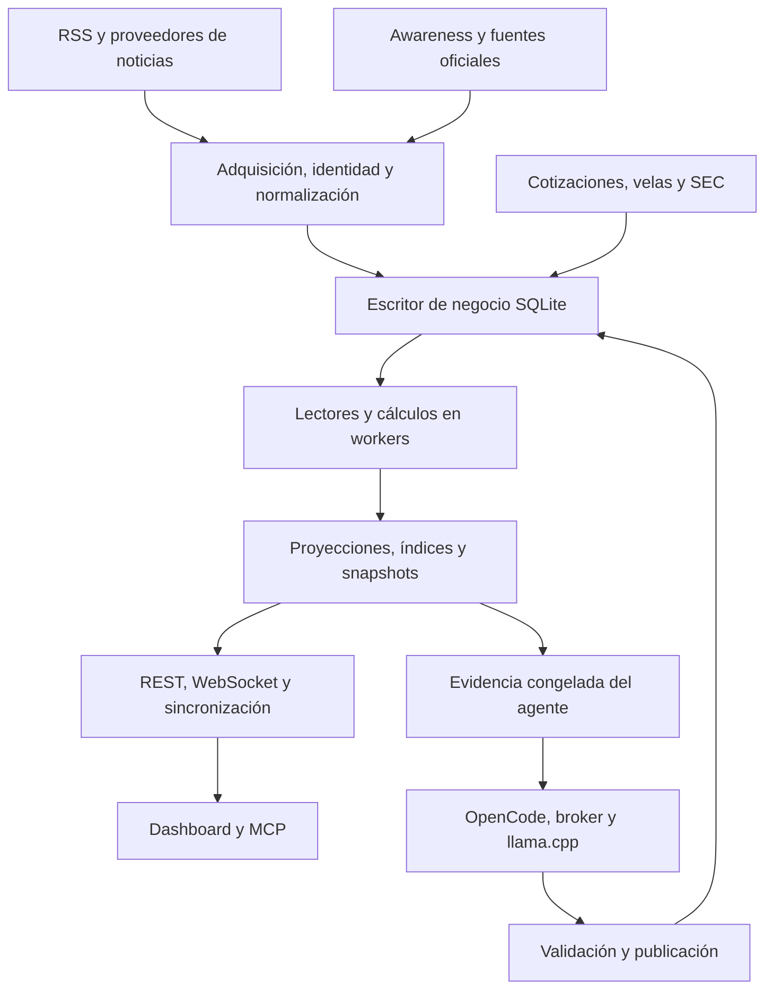
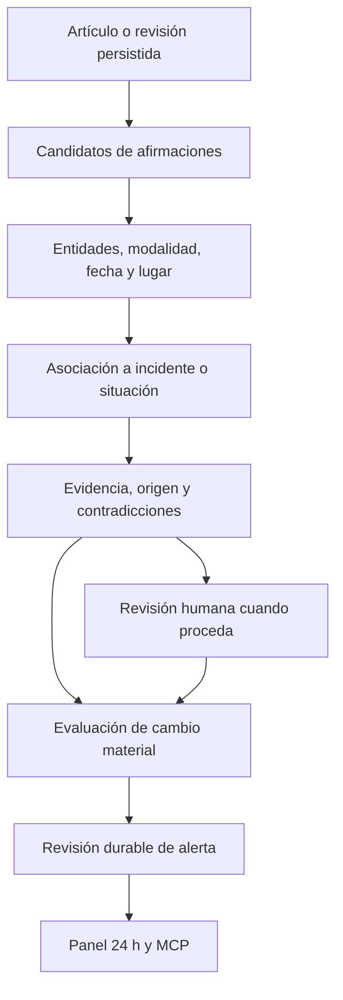

# OGID: diagnóstico técnico, dirección de producto y plan de implementación

Fecha: 25 de octubre de 2026. Revisión de GitHub y lecturas del servicio conectado realizadas a partir de las 16:55, Europe/Madrid.

> Diagnóstico histórico del 25/10. La implementación y el estado operativo posteriores se consultan en [ESTADO.md](implementation/ogid-evidence/ESTADO.md); los fallos o pendientes descritos aquí no se presuponen vigentes.

## 1. Recomendación ejecutiva

Orientaría OGID a una **plataforma de seguimiento geopolítico con comparación de fuentes, evidencias trazables y alertas de cambios relevantes**. Su unidad principal debería evolucionar de «noticia puntuada» a «situación con afirmaciones, fuentes y revisiones». La noticia original seguiría siendo accesible y conservaría su identidad.

La promesa de producto sería: **entender qué ha cambiado, quién lo afirma, qué evidencia existe, qué discrepa y qué sigue sin saberse**. Esto ofrece un criterio para decidir qué construir y para evaluar si funciona.

Los mercados encajan como una vista de consecuencias y exposición; el agente encaja como asistente que explica evidencia. Ambas capacidades aprovechan el núcleo informativo. Su disponibilidad y sus errores no deberían determinar si se adquieren noticias o se muestran alertas deterministas.

La prioridad no es maximizar el número de paneles ni de consultas. Es convertir la cobertura que ya tienes en información comparable, verificable y recuperable. Hay una base considerable para hacerlo sin sustituir RSS, SQLite, Node.js, el dashboard ni MCP.

La ausencia absoluta de subjetividad no es una garantía que pueda ofrecer un sistema editorial: elegir fuentes, idiomas, temas, umbrales y orden ya introduce decisiones. El objetivo implementable es **reducir sesgos evitables y hacer explícitas, versionadas y evaluables las decisiones restantes**. Pluralidad tampoco significa dar el mismo peso a una prueba y a una afirmación sin respaldo.

### Decisión de especialización

| Alternativa | Encaje con OGID | Recomendación |
|---|---|---|
| Agregador generalista de noticias | Aprovecha RSS, pero exige competir en demasiados temas y dificulta verificar cobertura | Mantener búsqueda y archivo amplios como capacidad transversal |
| Monitor geopolítico y de situaciones | Aprovecha países, conflictos, fuentes oficiales, revisiones, Awareness y alertas existentes | Adoptar como eje del producto |
| Analista de mercados basado en noticias | Aprovecha velas, instrumentos, SEC y evaluación; depende de una base de noticias fiable | Mantener como módulo especializado sobre el mismo núcleo |
| Asistente conversacional | Facilita explorar la información; introduce dependencia del modelo y validación semántica | Tratar como una interfaz adicional del núcleo |

Especializar el recorrido principal no requiere borrar capacidades actuales. Requiere una jerarquía clara: primero evidencia y situaciones; después interpretación y consecuencias.

## 2. Qué se ha comprobado y cuáles son los límites

Se han consultado las ramas y su comparación mediante GitHub; se han leído módulos de ingesta, clasificación, selección, almacenamiento, inteligencia, agente, contratos, alertas, frontend y auditorías recientes; se han consultado los resultados CI publicados; y se han realizado lecturas del servicio OGID conectado. También se han ejecutado reproducciones pequeñas de clasificación con el código descargado.

Esta revisión es un diagnóstico de arquitectura y producto con comprobaciones focalizadas. No es una auditoría exhaustiva de cada línea, una prueba de penetración, una ejecución local de toda la suite ni una certificación de producción. El dashboard se ha revisado por su HTML y JavaScript; no se ha validado en esta sesión el navegador de tu servidor ni el comportamiento visual completo. Los resultados de pruebas recogidos en los documentos del repositorio se distinguen de las comprobaciones realizadas aquí.

Niveles de evidencia utilizados:

- **Comprobado en código:** comportamiento visible en el commit fijado.
- **Observado en servicio:** resultado puntual de una lectura al runtime conectado.
- **Reproducido:** caso ejecutado de forma aislada durante esta revisión.
- **Documentado:** afirmación de una auditoría del repositorio; no equivale a repetir el ensayo.
- **Propuesto:** diseño o criterio de aceptación futuro.

Los anteriores MD de evaluación y SEC/ETF se han consultado en sus copias del repositorio. Los documentos históricos sirven para comprender causas y correcciones; sus incidentes no se presentan automáticamente como fallos vigentes.

## 3. Main, rama avanzada y servicio en ejecución

| Superficie | Identidad observada | Estado y significado |
|---|---|---|
| `main` | `b6edb69ca322153912278c13a4831065df6540df` | Base del 17 de octubre; CI del commit completado con éxito |
| `feat/agentic-intelligence` | `a1d0fb875cf9c2aea2475ad73f761b36abc60199` | Ocho commits por delante de main, cero por detrás; comparación devuelve 283 archivos afectados; CI del commit completado con éxito |
| Backend conectado | Contrato `1.9.0`; checkout al arranque `3ac9a1ab…`; `dirty=true` | Responde y persiste datos; el propio servicio declara `runningCommitVerified=false` |
| Adaptador MCP conectado | Versión `0.4.0`, contrato `1.6.0`; checkout al arranque `0fc9da2a…`; `dirty=true` | Existe desfase observable respecto al backend y al tip remoto; no demuestra incompatibilidad de todas las operaciones |

La rama enlazada es una continuación directa de main en este corte. La antigua `feat/close-prospective-intelligence` no es su sucesora: al compararla con el tip agentic resulta divergente, con un commit exclusivo y 68 por detrás. No la tomaría como base del nuevo trabajo.

El último commit remoto de agentic incorpora ajustes de MCP/OpenCode y dependencias; su mensaje indica que el shadow seguía con el runtime anterior. Esto es coherente con la identidad observada, pero los cambios locales impiden identificar el proceso únicamente por el SHA del checkout.

### Diferencias funcionales principales

| Área | Main | Agentic |
|---|---|---|
| Núcleo informativo | Adquisición, normalización, archivo, selección, riesgo y análisis | Conserva ese núcleo y corrige frescura, recuperación y coordinación |
| Persistencia | Infraestructura SQLite y workers, repositorios y adquisición SEC | Añade trabajos/snapshots del agente, más aislamiento de lectores, coordinación durable y migraciones hasta 022 |
| Dashboard | Noticias como panel principal; Awareness; inteligencia; mercados; espacio situacional | Añade brief y outlooks del agente; transforma el espacio situacional en `Geopolitical Alert Inbox` |
| IA | Capacidades previas de enriquecimiento | Broker, OpenCode, worker gestionado, catálogo de modelos, evidencia congelada y publicación validada |
| Alertas | Awareness y señales de investigación | Añade tablas, rutas, revisiones y estado por dispositivo para alertas geopolíticas |
| Operación | Diagnóstico y políticas de ejecución | Amplía telemetría, reconciliación, recuperación de lectores, checkpoint y pruebas operativas |

La rama contiene mejoras de infraestructura además de IA. Integrarla y hacer visibles todas sus funciones son decisiones separables: puede integrarse con funciones experimentales apagadas o en shadow, una vez satisfechas las garantías de recuperación y compatibilidad.

### Estado operativo observado

En el primer corte, a las 15:55 UTC / 16:55 de Madrid:

- Salud global `ok`, almacenamiento `ready`, aproximadamente 5 h 40 min de uptime.
- Archivo público: **140.071 artículos**. La muestra del worker, tomada unos minutos antes, contaba 140.052 artículos, 279.647 revisiones, 150.332 eventos, 41.688 velas y 2.764 eventos Awareness. Son cortes de tiempos distintos, no una transacción única.
- Cola de almacenamiento sin pendientes ni operaciones en curso en esa muestra.
- 19 instrumentos y 19 cotizaciones declaradas disponibles; proveedor efectivo Yahoo.
- 50 comandos fallidos acumulados y último código `AGENT_UNVERIFIED_NUMBER`. No son 50 fallos nuevos de SQLite ni 50 incidentes de esta revisión: falta su distribución temporal y por tipo.
- Archivo con `partial=true`, continuidad de adquisición `unknown` y constancia de un recorte de capacidad histórico. El dato de publicación más antiguo, de 1975, requiere interpretación y revisión de calidad temporal; no prueba por sí solo un error o cobertura continua desde ese año.
- Catálogo Awareness público: **22 entradas**, diez activas, cuatro bloqueadas, tres probing y cinco shadow. Las diez con estado operativo expuesto en la consulta corresponden a fuentes macroeconómicas estadounidenses. Varias fuentes de seguridad y marítimas siguen bloqueadas, en probing o shadow.

Esto permite afirmar que hay adquisición y persistencia operativas en el corte. No permite certificar continuidad de 24 horas, calidad semántica del agente, cobertura global ni estabilidad bajo toda la carga prevista.

### Pruebas y limitaciones de la rama

La auditoría más reciente documenta 1.035 pruebas backend, 30 MCP, comprobaciones de contratos e inventario de 83 rutas/92 operaciones. El CI del tip remoto también está verde. No se ha vuelto a ejecutar aquí esa suite.

La misma auditoría conserva resultados semánticos mixtos con inferencia real: brief y valoración geopolítica válidos; dos outlooks rechazados por cifras no verificadas; un chat inicial sin lectura acreditada y otro posterior válido. Los rechazos muestran que las guardias actúan; todavía hay que medir cuántos trabajos útiles terminan correctamente.

**Conclusión de madurez:** base avanzada y recuperable en evolución, con capacidades experimentales valiosas. Aún no hay evidencia suficiente en esta revisión para declarar un monitor OSINT profesional completo ni una IA predictiva validada.

## 4. Arquitectura actual y procesos

La forma más adecuada de describirla es un **monolito modular Node.js con procesos y workers auxiliares**, repositorios SQLite, proyecciones para lectura y varias interfaces. Ya existe separación parcial de lectura y escritura; no hace falta introducir una plataforma distribuida para este evolutivo.



El diagrama representa el flujo lógico. Las mutaciones de negocio deben seguir pasando por el propietario existente del escritor. Los procesos de lectura o checkpoint no deben convertirse en escritores independientes de datos de negocio.

| Proceso | Qué hace hoy | Lectura profesional del resultado |
|---|---|---|
| Ingesta RSS | Catálogo canónico, elegibilidad, límite global y por host, ETag/Last-Modified, cooldown, parseo, clasificación y deduplicación | Base útil que conviene preservar y ampliar |
| Proveedores de noticias | Integra NewsAPI, GNews, RSS y proveedores configurables; controla presupuesto y fallbacks | Proveedor de transporte y medio editor son entidades diferentes |
| Archivo | Conserva artículos, revisiones, fechas y procedencia; permite búsqueda fuera de la selección editorial | Debe ser la base de investigación, no solo las cien tarjetas visibles |
| Selección | Ventana temporal, criticidad, recencia, límites por fuente y huella de titular; calcula `analysisScore` | Es una política editorial y necesita explicación verificable |
| Riesgo por país | Combina volumen, sentimiento negativo y términos de conflicto | Indicador heurístico de actividad noticiosa; no riesgo real calibrado |
| Advanced Intelligence | Corpus, severidad, términos frecuentes, CII, hotspots, convergencia y anomalías | Describe señales del corpus observado, sujeto a cobertura |
| OSINT fusion | Proyecta noticias por país/tema y mezcla señales de mercado y predicción | Eventos analíticos derivados; no necesariamente incidentes físicos distintos |
| Awareness | Agenda, comunicados y eventos de fuentes admitidas, con fechas y revisiones | Buena base para alertas atribuidas; oficial no significa independiente |
| Investigación | Identidades de instrumentos, SEC, ledger de eventos, canales económicos y escenarios | Hay piezas de evidencia y origen que deben reutilizarse |
| Mercados | Cotizaciones, OHLCV, validación de cobertura, indicadores y contexto técnico | Hechos de mercado con fecha/calendario; separar de la interpretación de noticias |
| Impacto y predicción heurística | Puntúa presión de noticias, relación temática, momentum y señales por instrumento | Asociación y fuerza heurística; no causalidad ni probabilidad de éxito |
| Evaluación de forecasts | Registra pronósticos antes del resultado, calcula resultados, comparadores y métricas | Existe infraestructura; su existencia no acredita un modelo rentable o calibrado |
| Agente | Trabajos durables, leases/fences, snapshots, herramientas, validación numérica y citas, una reparación y publicación shadow/visible | Asistente controlado; medir utilidad y abstención además de errores bloqueados |
| Alertas geopolíticas | Comunica eventos oficiales admitidos y noticias elevadas/críticas; conserva revisiones y leído/archivado | Embrión existente del panel 24 h solicitado |
| Sincronización | Bootstrap compacto, revisiones, recuperación, polling coordinado y WebSocket | Mantener como transporte de proyecciones, evitando cálculos por visita |

Puntos de entrada relevantes: `backend/server.js`, `services/refreshOrchestratorService.js`, `storage/StorageManager.js`, `services/news/`, `services/intel/`, `services/awareness/`, `services/research/`, `services/agent/`, `storage/agentRepository.js`, `frontend/js/dashboard.js`, `frontend/js/agentIntelligence.js` e `integrations/ogid-mcp/`.

## 5. Gaps y errores prioritarios

Las prioridades siguientes expresan orden de implementación. Un riesgo de diseño no se presenta como una incidencia operativa demostrada.

| Prioridad | Hallazgo y evidencia | Consecuencia | Tratamiento |
|---|---|---|---|
| P0 | Identidades del adaptador y backend difieren; ejecución exacta no verificada | Diagnósticos y contratos pueden corresponder a versiones distintas | Manifiesto de release, capacidades compatibles y prueba de operación real |
| P0 | Publicación del agente sigue con fallos semánticos documentados | Una UI conectada puede producir pocas respuestas válidas | Mantener guardias, corpus de evaluación y shadow; medir éxito útil por tarea |
| P0 | `rankSourceCredibility` hace búsqueda parcial con alias `ap` | Un medio ajeno puede heredar una puntuación de AP | Resolver `publisherId` por identidad verificada y alias exactos |
| P0 | `strike` dispara `civil_unrest` incluso en `missile strike` | Se duplican categorías y sube artificialmente la severidad | Clasificación contextual y reglas de exclusión con regresiones |
| P1 | Muchas noticias exponen feed de búsqueda y no editor original | Medidor político y diversidad serían incorrectos | Separar canal de descubrimiento, publicación y origen informativo |
| P1 | Catálogo de 501 entradas contiene 435 búsquedas generadas | Se puede confundir número de consultas con diversidad de medios | Métricas por publishers, grupos propietarios y cadenas de origen |
| P1 | Metadatos del catálogo declaran inglés y búsquedas `en-US`/`US` | Sesgo de idioma, selección y geografía | Cobertura por idioma/región y admisión de fuentes locales |
| P1 | RSS pierde cobertura temática/país en ejemplos no ingleses | Subrepresentación o descarte de noticias relevantes | Idioma detectado, Unicode, aliases y extracción multilingüe evaluada |
| P1 | Fusión usa coordenadas del país mencionado | Falsa impresión de geolocalización de un ataque | Precisiones explícitas; ciudad solo con evidencia y desambiguación |
| P1 | Un artículo puede generar varios eventos por país y tema | Contar esos eventos como ataques infla incidencia y convergencia | Separar artículos, menciones, afirmaciones e incidentes |
| P1 | Clusters del agente agrupan por titular normalizado | No reúnen bien coberturas distintas del mismo suceso | Clustering por entidades, tiempo, lugar y tipo, con revisiones |
| P1 | `alertSync` lee últimas 500 noticias recibidas en 24 h | Ráfagas o caídas pueden dejar noticias sin examinar | Cursor durable y replay paginado; métricas de lag |
| P1 | `alertSync` identifica noticias por hash del título | Titulares cambiantes duplican alertas; títulos repetidos pueden colisionar entre sucesos | Identidad de incidente y relaciones explícitas a publicaciones/revisiones |
| P1 | Consulta de alertas no aplica una ventana 24 h; ordena por actualización | La bandeja actual no tiene aún la semántica temporal solicitada | Filtros de tiempo y selector «actualizadas»/«ocurridas» |
| P1 | Dos consultas Advanced por MCP terminaron en `OUTPUT_TOO_LARGE` | Capacidad anunciada no siempre consumible por el cliente | Proyección compacta y páginas/detalle por contrato, manteniendo el límite |
| P1 | Mantenimiento determinista se habilita condicionado al modo del agente | No se garantiza independencia de alertas frente a apagar IA | Separar ejecución determinista de inferencia y probar el modo sin modelo |
| P2 | CII y riesgo dependen fuertemente de volumen y reglas | Cobertura alta puede parecer conflicto alto | Mostrar cobertura y normalizar por oportunidad observada; validar contra incidentes |
| P2 | Varios módulos y archivos de coordinación grandes/concentrados | Cuesta cambiar dominios y revisar consecuencias | Extraer responsabilidades gradualmente con contratos, sin reescritura global |

### 5.1 Reproducciones concretas

En el clasificador RSS actual:

| Entrada | Resultado reproducido | Problema |
|---|---|---|
| `Japan Times` | Credibilidad `0.96` | Coincide con `ap`, no con una identidad AP verificada |
| `Capitol Gazette` | Credibilidad `0.96` | El mismo falso emparejamiento parcial |
| `Unknown Gazette` | Credibilidad `0.55` | Valor genérico que tampoco es una medida factual de fiabilidad |
| `Missile strike in Ukraine` | `conflict` y `civil_unrest`, puntuación 8 | `strike` se interpreta también como protesta/huelga |
| `Ataque con misiles en Ucrania` | Sin temas, puntuación 0, sin país | El mismo fenómeno pierde detección por idioma |
| `Удар ракетами по Украине` | Sin temas, puntuación 0, sin país | Pérdida similar en escritura cirílica |

Los dos primeros casos se reprodujeron con la tabla y función extraídas del código. Los tres últimos se ejecutaron importando el clasificador y sus dependencias locales descargadas. No representan la tasa de error del corpus; sí demuestran fallos deterministas que conviene cubrir con tests.

Hay además tablas distintas de credibilidad/fiabilidad en `rssClassifier.js` y `newsSelectionService.js`. Algunas puntuaciones llegan a ponderar información en CII. Deben consolidarse como metadatos explícitos con origen y metodología, o retirarse del papel de supuesta confianza factual.

Un matiz de ordenación: `newsSelectionService` calcula `analysisScore`, pero ordena primero mediante `compareNews`, que ya desempata por identidad. Por eso no se debe asumir que el peso de fiabilidad declarado en ese score gobierna efectivamente todo el ranking. Hay que definir y probar un único contrato de ordenación comprensible.

### 5.2 Muestra del feed actual

Una lectura de las cien noticias seleccionadas devolvió:

| Métrica del lote | Número |
|---|---:|
| Noticias con rol discovery | 79 |
| Sin `publisher` informado | 78 |
| Sin extracto | 90 |
| Transporte RSS | 90 |
| Transporte GNews | 10 |

No es una muestra aleatoria del archivo ni demuestra esos porcentajes para toda la app. Algunas etiquetas de publisher presentes también corresponden al feed de búsqueda, de modo que «no nulo» no equivale automáticamente a identidad editorial verificada.

Es evidencia suficiente para priorizar la procedencia y para abstenerse de analizar el texto completo de artículos que solo aportan titular. La falta de extracto puede obedecer a política de uso: no se debe rellenar con texto inventado ni sortear restricciones.

### 5.3 Qué reutilizar del ledger y qué no confundir

`EventLedger` ya distingue `officially-reported`, `unconfirmed`, rumor y orígenes independientes declarados; excluye orígenes desconocidos como corroboración. Esa cautela es correcta.

Su identidad `source-publication-v2` identifica publicaciones de fuente. Una publicación identificada no equivale a un incidente real fusionado entre medios. Conviene conservar ese ledger y construir las relaciones de afirmación/incidente encima, evitando romper las señales financieras que lo utilizan.

## 6. Objetividad operativa: tres dimensiones separadas

### A. Tendencia política del medio

Es un atributo contextual del editor, con evaluador, fecha, ámbito y metodología. Debe mostrarse como **«Tendencia del medio»**, no como probabilidad de verdad de la noticia.

Ground News explica que sus valoraciones políticas son de publicaciones, no de artículos individuales, y se sitúan en el contexto político estadounidense [S1]. Este detalle cambia el diseño: poner una etiqueta en una tarjeta no permite afirmar que ese texto concreto tenga exactamente el sesgo del medio.

### B. Encuadre del artículo

Describe el texto disponible: lenguaje valorativo, atribución, diferencia entre hecho y opinión, actores citados, incertidumbre, selección de términos o afirmaciones no sustentadas dentro del material analizado.

Una estimación automática puede ayudar si señala evidencia textual concreta y su alcance: titular, extracto o cuerpo autorizado. «No se cita la versión de B en este extracto» es comprobable; «el medio oculta B» no se deduce del extracto. La omisión solo debe evaluarse cuando existe un conjunto de comparación suficiente.

En la primera versión, no convertiría ese análisis en otro porcentaje político de apariencia precisa. Mostraría observaciones explicadas y una etiqueta de alcance. El modelo debe poder abstenerse.

### C. Estado de corroboración de la afirmación

Se refiere a un hecho específico: que ocurrió una explosión, su localización, la atribución de responsabilidad o el número de víctimas. Cada afirmación puede tener apoyos y contradicciones distintos.

Un comunicado acredita que su emisor hizo una afirmación. No convierte automáticamente esa afirmación en un hecho independiente confirmado. Dos artículos que copian el mismo comunicado o cable no aportan dos observaciones independientes. Dos orígenes tampoco son garantía automática de verdad.

### Cómo se traduciría a una tarjeta

Ejemplo ficticio, sin asignar etiquetas a medios reales:

> **Se reporta una explosión en la localidad X**  
> Medio A · publicado 16:05 · recibido 16:07  
> Tendencia del medio: centroizquierda · evaluación externa · ámbito España  
> Estado: reporte sin corroboración independiente  
> Cobertura del suceso: 4 medios, 1 cadena de origen identificada  
> Texto disponible: titular y extracto  
> Acciones: comparar coberturas · ver evidencias · seguir situación

La tendencia puede ocupar una mini escala y etiqueta textual en el pie de la tarjeta. Al pulsarla se abre el evaluador, la fecha, el ámbito y la explicación. `Sin evaluar`, `No aplicable` y `Evaluaciones discrepantes` son estados propios. No se colocan en el centro de la escala.

El detalle del suceso sí puede mostrar una barra de **distribución de medios por tendencia**. Debe especificar denominador, muestra y parte sin evaluar. Mantener separados:

| Conteo | Qué representa |
|---|---|
| Artículos | Número de publicaciones recuperadas |
| Medios | Editores distintos que publican sobre el tema |
| Grupos propietarios | Diversidad de propiedad editorial |
| Cadenas de origen | Independencia de la evidencia conocida |

La barra de tendencias describe medios; la corroboración utiliza cadenas de origen. Un grupo propietario distinto no demuestra que la evidencia sea independiente.

### Método de valoración recomendado

1. Resolver el editor y su edición/dominio de forma verificada.
2. Incorporar datos de evaluadores con atribución y condiciones de uso compatibles.
3. Conservar sus evaluaciones originales antes de cualquier normalización.
4. Definir un mapeo versionado, con ámbito político y temporal.
5. Mostrar desacuerdos; evitar promediar escalas incompatibles sin justificación.
6. Habilitar revisión editorial y registro de correcciones.

AllSides describe revisión multiparte y encuestas ciegas, además de niveles de confianza [S2]. Eso orienta una futura metodología propia: muestra equilibrada, revisores distintos, acuerdo entre anotadores, evidencia y revisión. Una sola clasificación de un LLM no sustituye ese proceso.

La página de AllSides consultada indica BY-NC 4.0 con atribución y un acuerdo para uso comercial. Hay que confirmar la autorización y el alcance de cualquier importación concreta antes de redistribuir su dataset [S2]. Que una valoración sea visible en web no concede automáticamente permiso para incorporarla a un producto comercial.

En geopolítica, izquierda/derecha no basta. Añadir por separado país editorial, idioma, propiedad/financiación, vínculo estatal documentado, rol oficial/parte interesada y alcance local o internacional. Ninguno de esos atributos determina por sí solo verdad o falsedad.

## 7. Ampliar fuentes manteniendo la arquitectura

El catálogo actual contiene 66 entradas RSS y 435 búsquedas generadas. Las 501 entradas declaran inglés; las generadas usan Google News con locale estadounidense. Es cobertura de consultas, no 501 redacciones independientes ni 501 orígenes informativos.

La ampliación debe introducir entradas y metadatos sobre el catálogo/scheduler canónicos existentes. Mantener sus identidades, callbacks de archivado, límites por host, cooldowns y presupuestos. El enriquecimiento de sesgo o incidentes se ejecutará después de persistir; no retrasará la adquisición.

### Matriz de cobertura

Para cada región prioritaria, registrar disponibilidad de:

- Medios locales en idioma original y medios de alcance nacional.
- Agencias y corresponsalías con reportería directa.
- Fuentes internacionales de distintas regiones editoriales.
- Autoridades, servicios de emergencia, organismos internacionales y actores implicados, siempre atribuidos.
- Organizaciones humanitarias, observatorios y verificadores con metodología conocida.
- Perspectivas políticas evaluadas donde la escala tenga sentido.

La diversidad de perspectivas y la diversidad de evidencia se medirán por separado. Añadir una fuente con opinión distinta no compensa automáticamente una carencia de reportería local.

### Metadatos de fuente

Extender sin romper el catálogo: `publisherId`, edición, dominios y alias verificados, países editoriales, idiomas, rol, grupo propietario cuando esté documentado, referencias de financiación/propiedad, evaluaciones políticas, política de contenido, cadencia, última verificación y estado operativo.

Separar siempre:

- `transportProvider`: NewsAPI, RSS, GNews u otro transporte.
- `discoverySourceId`: feed, consulta o API por la que se encontró.
- `publisherId`: editor que publicó el artículo.
- `originChainId`: origen conocido de los hechos o de la pieza sindicada.

Google News es descubrimiento; no hereda ni impone una tendencia política a los artículos que indexa. La identidad del editor se obtiene preferentemente de metadatos explícitos del item y dominios validados. Un sufijo del titular puede sugerir una identidad, pero no bastará para verificarla. Conservar candidatos y estado de resolución.

Si resolver una URL exige red, hacerlo mediante adquisición acotada, caché, controles de URL/redirects y presupuesto, nunca al renderizar cada tarjeta ni desde el escritor SQLite. Mantener URL original, URL final verificada y aliases sin cambiar retroactivamente los IDs de noticias existentes.

### Admisión gradual

1. Registrar candidato y razón concreta de cobertura.
2. Probar contrato, fecha, idioma, estabilidad y política de contenido.
3. Observar en shadow su rendimiento y duplicación.
4. Promover con métricas y responsable de revisión.
5. Degradar o pausar con causa visible cuando falle; conservar histórico y capacidad de recuperación.

La cobertura útil debe expresarse como fuentes previstas/activas, idiomas observados, salud, última adquisición, lag y grupos distintos. No como «cobertura total» ni como ausencia de sucesos cuando un país no tiene fuentes operativas.

## 8. Evolución hacia un motor de situaciones y alertas 24 h

### Qué existe y qué falta

La rama ya expone `/api/alerts/v1/geopolitical`, historial de revisiones y leído/archivado por dispositivo. El frontend ya consume esa bandeja. `alertSync` genera alertas desde fuentes oficiales admitidas y noticias de severidad elevada/crítica. No hay que construir una bandeja paralela.

Falta pasar de alertas por publicación/titular a **seguimiento de incidentes y cambios de afirmaciones**. Su cobertura estará limitada por fuentes, cadencias, fallos y capacidad; un sistema de noticias no puede prometer detectar cualquier ataque en cualquier localidad.

### Flujo propuesto



Cada etapa recibe una revisión conocida y produce un resultado idempotente. Los cambios se confirman por el escritor actual. Reutilizar cambios/revisiones existentes como mecanismo de notificación; incorporar un registro transaccional de trabajo pendiente si falta un checkpoint fiable. No hace falta un segundo sistema de colas externo para el primer piloto.

### Modelo de dominio mínimo

| Entidad | Función | Reglas esenciales |
|---|---|---|
| Publicación | Artículo o comunicado original y revisiones | Preservar identidad, URL, fechas y política de uso |
| Afirmación | Sujeto, acción, objeto, tiempo, lugar y atribución | Conservar negación, rumor, hipótesis y futuro; no convertirlos en hechos |
| Evidencia | Fragmento autorizado o referencia que apoya/contradice | Fuente, revisión, disponibilidad temporal y cadena de origen |
| Incidente | Suceso concreto compatible en lugar y tiempo | ID durable; separación/fusión auditadas; campos disputados conservados |
| Situación | Conflicto o proceso que reúne varios incidentes | Alcance geográfico/temático y cronología |
| Revisión de alerta | Cambio relevante para el usuario | Idempotencia, motivo, antes/después y severidad separada de corroboración |

No reutilizar sin matices el nombre genérico `events` para más fenómenos distintos. El repositorio ya contiene eventos analíticos y publicaciones de investigación. Un dominio de incidentes puede relacionarlos sin redefinir sus IDs.

### Ejes de estado separados

- **Procedencia:** comunicado oficial, reportería, testimonio, contenido social, análisis o descubrimiento.
- **Corroboración de cada afirmación:** sin evaluar, una fuente, corroboración parcial, múltiples orígenes comprobados, disputada o refutada.
- **Ciclo del incidente:** reportado, en desarrollo, cerrado, fusionado o dividido.
- **Ciclo editorial:** vigente, corregido o retirado, con historial.

Las contradicciones no obligan a borrar evidencia ni a escoger la versión mayoritaria. Por ejemplo, existencia de una explosión corroborada, autoría desconocida y cifras de víctimas disputadas pueden coexistir.

### Qué significa «24 h»

Por defecto mostrar **cambios detectados en las últimas 24 horas**, incluyendo correcciones sobre incidentes antiguos. Ofrecer otra vista para **sucesos ocurridos en las últimas 24 horas** cuando exista fecha de ocurrencia acreditada.

Guardar `eventTime` o rango estimado, precisión temporal, `publishedAt`, `receivedAt`, `firstDetectedAt`, `updatedAt` y fecha de emisión de alerta. Una noticia recibida hoy sobre un hecho de ayer se muestra como actualización o reporte tardío, sin inventar una hora de ocurrencia.

### Geolocalización

Las coordenadas del país actual sirven como referencia agregada, no para ubicar un ataque. La nueva extracción debe distinguir país mencionado, ubicación del incidente y origen editorial.

Mantener candidatos, topónimo original, país/región/ciudad, gazetteer y versión, precisión y método. Ante lugares homónimos o evidencia insuficiente, mostrar región o ubicación desconocida. No poner un pin de precisión de calle si solo se conoce el país. Los límites y denominaciones disputados deben poder representarse sin resolverlos editorialmente de forma implícita.

### Ejemplo de funcionamiento

1. Una fuente local publica un reporte de explosión. Se guarda artículo y afirmación atribuida; puede aparecer en la bandeja de reportes sin verificar.
2. Varios medios lo copian. Aumenta cobertura editorial; la corroboración sigue con un origen conocido.
3. Otra fuente aporta observación independiente. Se actualiza el estado del campo que realmente respalda, conservando atribución y dudas.
4. Un comunicado reclama responsabilidad. Se añade la reclamación como afirmación oficial/de parte, sin convertirla en atribución verificada.
5. Una imagen resulta de otro día. La revisión marca esa evidencia como refutada y recalcula las afirmaciones dependientes.
6. El usuario ve una única situación con cambios y correcciones, y puede abrir las publicaciones originales.

El Verification Handbook propone verificar procedencia, fuente, fecha y lugar y combinar herramientas con revisión humana [S3]. Es una guía para el proceso, no una promesa de verificación automática de contenido social.

### Fuentes y tiempo real

Para un piloto, combinar noticias locales admitidas, agencias, fuentes oficiales, marítimas, humanitarias y verificadores. ACLED puede ser útil para contexto y evaluación retrospectiva según cobertura y acceso; su codebook describe publicación semanal tras revisión, por lo que no debe ser la única dependencia de una alerta inmediata [S4]. Comprobar cada producto concreto, ya que pueden existir modalidades con cadencias diferentes.

Las fuentes sociales o canales de mensajería pueden añadirse más adelante con acceso permitido y procedencia clara. Primero hay que resolver las cadenas de origen y las correcciones; de otro modo, aumentarían velocidad aparente y ruido.

### Política de alertas

La severidad y el estado de verificación deben ser visibles a la vez. Un reporte muy grave puede requerir atención aun sin verificar, pero se presentará en un carril explícito de reporte preliminar. «Grave» no debe transformarse en «confirmado» por el color de una tarjeta.

Generar notificación nueva por cambio material: nuevo lugar o alcance acreditado, corroboración de un campo importante, corrección, cambio de cifras o resolución. Usar cooldown y agrupación para republicaciones. Mantener una clave de emisión por incidente, tipo de cambio, revisión y política.

Las acciones leído/archivado existentes siguen siendo preferencias del dispositivo o usuario. No borran la evidencia. Las notificaciones externas requerirían su propio consentimiento y gestión de entrega; no se incluyen en esta revisión.

## 9. Arquitectura de implementación compatible

### Mantener y ampliar

- Catálogo y scheduler RSS canónicos.
- Archivo y revisiones SQLite como fuente de información.
- `StorageManager` como punto de admisión y coordinación.
- Lectores de consultas y de cálculos existentes.
- Contratos de operaciones y proyecciones públicas.
- Bootstrap, sincronización y WebSocket como transporte.
- Ledger y estado de alertas existentes, con adaptadores compatibles.
- Snapshots congelados y guardias del agente.

La documentación de SQLite explica que WAL permite lectores concurrentes, mantiene un escritor a la vez y puede retener checkpoint por lecturas largas [S5]. Por ello conviene mantener transacciones cortas y paginadas, liberar lectura antes de esperar inferencia/red y vigilar deuda y edad de checkpoint. Node.js recomienda evitar trabajo largo en el event loop [S6]. Esto respalda la dirección de workers ya adoptada.

### Nuevas responsabilidades lógicas

Propuesta de módulos, adaptable a las convenciones reales al implementar:

| Responsabilidad | Ubicación orientativa | Dependencias |
|---|---|---|
| Identidad editorial | `services/news/publisherIdentity.js` | Catálogo, normalizador y aliases |
| Evaluaciones de medios | `services/news/sourceAssessments.js` | Repositorio de evaluaciones versionadas |
| Cobertura plural | `services/news/coverageService.js` | Archivo anterior al recorte editorial |
| Extracción de afirmaciones | `services/incidents/claimExtraction.js` | Revisiones autorizadas y modelos/reglas |
| Asociación de sucesos | `services/incidents/incidentAssociation.js` | Entidades, tiempo, lugar y origen |
| Corroboración y conflictos | `services/incidents/evidenceAssessment.js` | Relaciones apoyo/contradicción |
| Política de cambios | `services/incidents/alertPolicy.js` | Revisiones y estado actual |

No crear tablas ni endpoints únicamente por estos nombres propuestos: mapear antes los repositorios existentes y justificar cada incorporación. Las migraciones serán aditivas después de la versión real vigente; no fijar de antemano un número que pueda estar ocupado.

### Reglas de ejecución

1. La adquisición confirma sus datos antes de solicitar enriquecimientos.
2. Cada trabajo usa artículo/revisión, método y versión como clave idempotente.
3. Extracción y asociación corren en ejecución acotada fuera del escritor.
4. La confirmación comprueba que las revisiones de entrada siguen siendo válidas.
5. Usar cursor durable para reanudar tras caída y paginar el backlog; `LIMIT 500` no puede significar cobertura completa.
6. Reutilizar coordinación existente y límites por ítems/bytes; no añadir un segundo scheduler por pestaña.
7. El frontend lee proyecciones. Abrir o refrescar el dashboard no dispara adquisición o inferencia indiscriminadas.
8. Mantener estados separados de salud del proceso, progreso, frescura, cobertura y corroboración.
9. Publicaciones de IA nunca se reintroducen como evidencia independiente del mismo suceso.
10. Sin modelo disponible, siguen funcionando noticias, búsqueda, comparación de metadatos y alertas deterministas.

### Contratos y MCP

Publicar operaciones de lectura para evaluaciones de fuente, coberturas, situaciones, incidentes, afirmaciones, revisiones y evidencia autorizada. Reutilizar rutas existentes donde sea posible y conservar las de alertas durante la transición.

Los contratos deben especificar filtros, ventana temporal, orden, tamaño máximo, cursor estable, revisión y significado de ausencia de datos. El cliente conectado en esta revisión anuncia operaciones agent en capacidades, pero su esquema de herramientas no ofrece todas ellas. Hace falta probar la capacidad desde el cliente real, además de comparar inventarios internos.

La solución a `OUTPUT_TOO_LARGE` es una proyección consumible: resumen compacto, paginación y detalle por ID; no elevar el límite global ni truncar silenciosamente evidencia. Los chunks del agente resuelven un caso diferente y no sustituyen automáticamente la paginación de Advanced o de incidentes.

### Seguridad aplicada al nuevo alcance

El contenido de fuentes y las salidas del modelo son datos no confiables. Mantener escapado HTML, saneamiento, consultas parametrizadas, política de URLs y redirecciones, límites de tamaño/tiempo y privilegios mínimos. El modelo propone relaciones o explicaciones; la aplicación valida IDs, revisiones y permisos antes de confirmar. OWASP documenta la inyección indirecta a través de contenido recuperado y recomienda controles en las herramientas, no confiar solo en instrucciones al modelo [S7].

Esta recomendación no afirma que se haya encontrado una vulnerabilidad explotable en el despliegue. Define el límite de seguridad necesario para la nueva adquisición y extracción.

SQLite sigue siendo una opción razonable para un despliegue en un host si la carga cabe en sus presupuestos. Reconsiderar almacenamiento o distribución cuando medidas de latencia, escritura, crecimiento, disponibilidad o multitenencia lo exijan; no por añadir etiquetas de sesgo. La alta disponibilidad entre hosts sí exigiría una decisión arquitectónica adicional.

## 10. Dirección del dashboard

Organizaría la navegación por tareas, evitando que todos los análisis compitan en una única pantalla:

| Vista | Pregunta que resuelve | Contenido principal |
|---|---|---|
| Noticias | ¿Qué se está publicando y desde qué perspectiva? | Feed, tendencia del medio, procedencia, filtros y acceso a comparaciones |
| Situaciones / 24 h | ¿Qué cambió y qué merece atención? | Incidentes, actualizaciones, contradicciones y seguimiento |
| Fuentes y cobertura | ¿Qué estoy viendo y qué puede faltar? | Matriz de idiomas/regiones, evaluaciones, propiedad, salud y metodología |
| Mercados | ¿Qué exposición o reacción observada se relaciona con esto? | Instrumentos, velas, hechos económicos y escenarios experimentales |
| Administración | ¿Funciona el sistema y por qué se degrada? | Pipelines, jobs, contratos, versiones, cuotas, colas y fallos |

El agente puede abrirse contextual a una noticia o situación: «resume diferencias», «qué evidencia cambió», «qué sabemos del lugar». Debe mostrar el corte temporal y las referencias consultadas.

En el feed, priorizar titular, editor real, fechas, estado y motivo de relevancia. Mantener el aviso de noticias nuevas y preservar foco/scroll. Las etiquetas políticas tendrán texto accesible además de color y detalle usable en móvil. El drawer debe informar cuándo solo existe titular o extracto.

CII, hotspots y anomalías pueden pasar a un contexto de situación o una vista analítica. Antes de destacarlos como riesgo profesional, cambiar su lenguaje a «actividad informativa observada» o explicar su carácter heurístico con acceso a metodología. Un aumento de fuentes activas no debería parecer por defecto un aumento de ataques.

## 11. Hoja de ruta por entregas

Las fases son orden de dependencia, no estimaciones de fechas. Cada PR debe ser revisable y tener alcance acotado.

### Fase 0. Cerrar una base operativa identificable

**Trabajo:** fijar artefactos backend/adaptador, dependencias, configuración desplegable y manifiesto; revisar CI del tip; confirmar migraciones y backup recuperable; ejecutar contratos reales y la observación prolongada pendiente. Clasificar por separado fallos de validación, transporte, consultas y writer.

**Aceptación:** adquisición independiente de frontend/IA; recuperación después de reinicio sin duplicar publicaciones; contratos efectivos compatibles; ningún resultado parcial presentado como válido; incidentes del ensayo resueltos o documentados con causa. Si cambia el artefacto durante una prueba de continuidad, abrir una cohorte nueva. Un reinicio deliberado valida recuperación, no continuidad ininterrumpida.

**Integración:** revisar la rama con guardias intactas. Integrar código y activar IA visible son decisiones distintas. Si se necesita un hotfix en main, aislar el parche y sus dependencias; evitar arrastrar accidentalmente todo el esquema del agente.

### Fase 1. Identidad y calidad básica de noticias

**Trabajo:** publisher verificado, canal de descubrimiento separado, aliases exactos; corregir AP/strike; cobertura Unicode y evaluación multilingüe; contrato único de severidad y ordenación; metadatos de alcance textual.

**Aceptación:** AP no coincide con Japan/Capitol; ataque y huelga se distinguen; noticias fuera del inglés no reciben «low» solo por falta de soporte; editor desconocido sigue desconocido; IDs y revisiones históricos se conservan.

**Primer resultado visible:** tarjetas con editor correcto o estado pendiente y clasificación menos engañosa.

### Fase 2. Tendencia política y transparencia de fuentes

**Trabajo:** repositorio de evaluaciones con evaluador/ámbito/fecha/método; importación autorizada; mini medidor por tarjeta; detalle metodológico; discrepancia y sin evaluar; panel de cobertura por medios/idiomas/regiones.

**Aceptación:** no se inventa una etiqueta al faltar datos; la edición correcta recibe su evaluación; no se hereda tendencia de Google News; cambiar la evaluación no reescribe hechos históricos; el esquema distingue lectura actual y evaluación vigente en una fecha pasada.

**Primer resultado visible:** función similar a la solicitada de Ground News, con alcance explícito de «medio».

### Fase 3. Comparación de coberturas y afirmaciones

**Trabajo:** asociación de artículos del mismo suceso; orígenes de sindicación; extracción de afirmaciones con negación/modalidad/tiempo; comparar coincidencias y diferencias. Conservar clusters existentes como contexto sin fingir que eran incidentes verificados.

**Aceptación:** cinco copias de una agencia siguen siendo un origen conocido; dos sucesos de igual titular en fechas distintas no se fusionan; dos titulares distintos del mismo hecho sí pueden agruparse con evidencia; merge/split quedan registrados; opiniones y predicciones no se convierten en ataques ocurridos.

### Fase 4. Motor 24 h sobre la bandeja existente

**Trabajo:** cursor incremental durable para `alertSync`; dominio de incidentes/situaciones; relaciones de evidencia; ventanas «cambiado»/«ocurrido»; correcciones y cambio material; scheduler determinista separado de inferencia.

**Aceptación:** una ráfaga superior a 500 noticias se procesa sin pérdidas silenciosas; reiniciar reanuda desde el último commit; las correcciones reaparecen; una noticia antigua no se convierte en un ataque nuevo; los orígenes desconocidos no corroboran; todo funciona con IA desconectada.

### Fase 5. Piloto geográfico y ampliación de fuentes

**Trabajo:** seleccionar dos o tres situaciones con fuentes contrastables; empezar por zonas con presencia útil en OGID, por ejemplo Ucrania/Mar Negro y mar Rojo; admitir medios locales y originales multilingües; revisión humana de una muestra; medir duplicación, errores y latencia.

**Aceptación:** matriz de cobertura publicada; fuentes configuradas, sanas y realmente consultadas diferenciadas; fechas y precisión geográfica visibles; métricas por idioma y origen; lag compatible con la promesa del piloto. Las zonas concretas se eligen según acceso y fuentes verificadas, no solo popularidad.

### Fase 6. Analista asistido e impactos

**Trabajo:** síntesis de situación con evidencia y contradicciones; cronologías; resúmenes de cambios; relaciones con energía, transporte, sanciones e instrumentos. Conectar la evaluación existente para medir hipótesis sin convertir correlación en causalidad.

**Aceptación:** cada afirmación importante enlaza a evidencia elegible; correcciones invalidan explicaciones dependientes; los números provienen de rutas validadas; `probability=null` cuando no exista modelo probabilístico evaluado. Medir calidad útil por tarea, no solo que el runtime siga conectado.

## 12. Métricas, pruebas y objetivos

### Indicadores principales de producto

- Proporción de alertas prioritarias con cambio material y evidencia suficiente en revisión humana.
- Tiempo desde recepción de una publicación relevante hasta disponibilidad de su alerta.
- Duplicados, retractaciones y correcciones detectadas y propagadas.
- Cobertura efectiva por región, idioma, medio y cadena de origen.
- Porcentaje sin publisher resuelto y sin evaluación política.
- Afirmaciones con atribución/tiempo/lugar correctos y porcentaje de abstención.
- Utilidad del agente: trabajos con respuesta válida, útil y citada, por tarea y con denominador total.

Medir por separado publicación→recepción, recepción→persistencia y persistencia→alerta. El sistema controla sobre todo los dos últimos; la primera depende también del proveedor y de su cadencia. Los datos históricos de primera observación pueden servir para reconstruir esa latencia si existen, sin inventarlos.

La cobertura de incidentes solo puede evaluarse contra un conjunto de referencia definido. No se puede medir recall de «todos los ataques del mundo» a partir del propio feed.

### Objetivos iniciales propuestos, sujetos a medir el servidor

| Área | Objetivo de piloto | Cómo interpretarlo |
|---|---|---|
| Lecturas compactas del dashboard | p95 ≤ 500 ms con datos calientes; arranque frío medido aparte | Objetivo de ingeniería, no resultado actual |
| Procesamiento local de cambio | p95 ≤ 60 s desde persistencia hasta alerta determinista | Excluye retraso de publicación/proveedor; ajustar con baseline real |
| Páginas de escritura | Presupuesto orientativo 250 ms y ausencia de transacciones largas recurrentes | Perfil de hardware y fsync condicionan el resultado |
| Pérdidas/duplicación | Cero pérdidas silenciosas en replay y cero emisiones duplicadas para la misma clave | Verificar con ráfagas, reinicios y ACK incierto |
| Etiquetas políticas | 100% con procedencia o estado explícito sin evaluar/no aplicable | No exige inventar etiquetas para elevar cobertura |
| Alertas prioritarias | Meta inicial de precisión ≥ 90% en conjunto etiquetado | Publicar tamaño de muestra, criterio y errores; no promesa global |

No convertir estos valores en límites rígidos de producción sin medir carga, almacenamiento y presupuesto. La primera entrega debe aportar un baseline reproducible.

### Evaluación editorial y semántica

Crear un conjunto inicial propuesto de unas 300 publicaciones y 100 incidentes con distribución por idioma, región, tipo, negación, rumor, republicación, corrección y precisión geográfica. Separar entrenamiento/ajuste de evaluación temporal. Dos anotadores pueden etiquetar una parte compartida y registrar desacuerdos; después resolverlos con una guía, sin borrar la incertidumbre original.

Medir precisión/recall por clase, errores de localización, fusiones y divisiones incorrectas, independencia mal atribuida, falsos confirmados y abstenciones. No presentar una tasa global como si todos los idiomas fueran equivalentes. La normalización política requiere su propio protocolo, no el mismo test de clasificación de incidentes.

### Pruebas de aceptación imprescindibles

1. Diferencia entre ataque, amenaza futura, simulacro, negación y opinión.
2. Un cable republicado frente a reportes independientes; propiedad compartida frente a origen compartido.
3. Noticias en varios idiomas, topónimos transliterados y lugares homónimos.
4. Fechas desconocidas, publicación tardía, correcciones, cambios de zona horaria y reloj incoherente.
5. Edición de un titular, dos sucesos con igual título y cluster fusionado/dividido.
6. Más de 500 nuevas revisiones entre ejecuciones, reinicio entre cómputo y commit y repetición de un resultado ya confirmado.
7. Writer ocupado, lector recuperado, checkpoint retenido, proveedor lento y modelo caído, preservando progresos confirmados.
8. Paginación consistente con revisiones concurrentes y una respuesta que alcance el límite de bytes.
9. Tarjetas accesibles en móvil/teclado, colores sin significado exclusivo y scroll/foco preservados.
10. Contenido externo malicioso, URLs inesperadas e intentos de provocar acciones o citas ajenas al snapshot.

## 13. Ideas adicionales ordenadas por valor

| Idea | Valor | Momento |
|---|---|---|
| «Qué cambió desde mi última visita» | Reduce repetición y da sentido al estado de leído existente | Junto al panel 24 h |
| Comparador de titulares y hechos por suceso | Permite ver encuadres sin que OGID imponga una versión única | Tras resolver publisher y agrupación |
| Cronología de afirmaciones y correcciones | Hace auditable el desarrollo de una noticia | Con incidentes y revisiones |
| Seguir situaciones, lugares y actores | Convierte el feed en herramienta de seguimiento | Tras el piloto de incidentes |
| Vista de carencias de cobertura | Distingue silencio informativo de ausencia de incidentes | Desde fuentes/cobertura |
| Detección de cobertura desigual | Ayuda a descubrir temas con perspectivas limitadas | Cuando haya muestra suficiente y salud conocida |
| Verificar fecha/origen de material audiovisual | Mejora investigación de reportes sensibles | Tras trazabilidad y revisión humana |
| Informe de situación exportable con fuentes | Facilita compartir hallazgos y cortes temporales | Tras estabilizar lectura y evidencia |
| Exposición por rutas marítimas, energía o sanciones | Conecta geopolítica y consecuencias reales | Vertical posterior sobre situaciones fiables |
| Evaluación pública del sistema y metodología | Aumenta confianza y permite detectar regresiones | Desde el primer piloto |

Una cobertura desigual solo describe lo observado en OGID durante una ventana, con fuentes activas y evaluadas. No basta para acusar a un medio de ocultar un hecho. Una caída de RSS puede producir el mismo patrón aparente.

La siguiente inversión de desarrollo debería concentrarse en identidad, trazabilidad y comparabilidad. Las predicciones de precios, la expansión mundial de fuentes sociales y un rediseño completo del frontend añaden dependencias que conviene abordar cuando el núcleo tenga medidas de calidad.

## 14. Prompt maestro para Codex: implementación por entregas

El siguiente bloque convierte la dirección propuesta en instrucciones de desarrollo. Para empezar, el alcance ejecutable recomendado es la entrega A; las siguientes se apoyan en sus contratos. No se ha modificado el repositorio como parte de este análisis.

```text
Actúa como senior engineer de OGID con experiencia en Node.js, SQLite, RSS,
contratos API, frontend y sistemas de análisis de noticias con evidencias.

OBJETIVO DE PRODUCTO
Evolucionar OGID a seguimiento geopolítico con fuentes comparables, afirmaciones
trazables y situaciones/alertas 24 h. Mantener el pipeline canónico de adquisición.
Mercados y agente consumen el mismo núcleo de datos.

PUNTO DE PARTIDA
El análisis del 25/10/2026 tomó main b6edb69ca322153912278c13a4831065df6540df
y feat/agentic-intelligence a1d0fb875cf9c2aea2475ad73f761b36abc60199.
No asumas que siguen siendo HEAD. Lee AGENTS.md si existe, estado git, rama,
diff y auditorías actuales; conserva cambios del usuario. Verifica qué se ha
integrado y actualiza el diagnóstico antes de editar. No reviertas a esos SHAs.

REVISA COMO MÍNIMO
backend/services/news/{newsSourceCatalog,rssCanonicalCatalog,
rssCanonicalPipeline,rssClassifier,rssDeduplicator,newsSelectionService,
articleIdentity}.js y providers/rssProvider.js;
backend/utils/{countryCatalog,newsOrder,sentimentRules}.js;
backend/services/{refreshOrchestratorService,riskEngineService}.js;
backend/services/intel/; backend/services/research/eventLedger.js;
backend/services/agent/{maintenance,worker,contracts}.js;
backend/storage/{StorageManager,businessRuntime,agentRepository}.js;
backend/contracts/ogidOperations.js; backend/routes/agentRoutes.js;
frontend/index.html y frontend/js/{dashboard,agentIntelligence}.js;
integrations/ogid-mcp/ y docs/audits/2026-10-24/live-stability-diagnosis.md.

INVARIANTES
1. Mantén fuentes existentes, histórico, identidades y revisiones; las nuevas
   fuentes se añaden al catálogo y scheduler actuales.
2. Todas las mutaciones de negocio pasan por el propietario SQLite existente.
   No añadas otro escritor ni una cola externa sin necesidad medida.
3. Red, inferencia y cálculos largos quedan fuera de transacciones de escritura
   y del event loop HTTP. Usa lectores/workers y presupuestos existentes.
4. Frontend y MCP leen proyecciones acotadas; cargar una pantalla no debe
   multiplicar adquisición o inferencia.
5. Migraciones aditivas después de la versión vigente, con replay reanudable.
   No edites migraciones ya aplicadas ni reemplaces la base operativa.
6. Desconocido no significa neutral, falso, estable ni ausencia de incidentes.
7. Tendencia del medio, encuadre del texto y corroboración son campos distintos.
8. Oficial significa atribuido al emisor, no corroborado independientemente.
   Republicaciones no son orígenes independientes; desconocido no corrobora.
9. Conserva guards numéricas, citas, fences, leases, límites y shadow del agente.
   No los relajes para conseguir una respuesta aceptada.
10. Sigue las autorizaciones operativas de la sesión. No actives publicación
    visible, notificaciones externas ni cambios de producción que no formen
    parte del alcance autorizado. Prepara cambios y validación revisables.

ENTREGA A — IDENTIDAD Y CLASIFICACIÓN BÁSICA
Implementa primero esta entrega como unidad revisable y completa.
- Separa transportProvider, discoverySourceId, publisherId y originChainId.
- Reutiliza metadatos explícitos de items RSS y alias/dominios verificados;
  distingue candidatos de identidad resuelta. No deduzcas editor fiable solo
  del sufijo de un titular ni del feed Google News.
- Preserva IDs, URL original, URL final cuando se verifique y aliases históricos.
- Sustituye emparejamientos parciales de credibilidad: 'ap' no puede coincidir
  con Japan Times ni Capitol Gazette. Centraliza evaluaciones/metodologías y
  no conviertas el valor heredado en una probabilidad de verdad.
- Corrige strike militar frente a huelga/protesta. Trata negación, futuro e
  idioma no soportado con estados explícitos; no confundir fallo de extracción
  con low severity o ausencia de país.
- Define un contrato único de selección/ordenación. Revisa que analysisScore
  no quede anulado por un desempate previo por identidad en compareNews.
- Expón editor resuelto/desconocido y alcance textual en las tarjetas/detalle.
- Añade solo pruebas relevantes a esos comportamientos y compatibilidad.
- Entrega baseline de cobertura y explica cualquier diferencia de resultados.

ENTREGA B — EVALUACIONES Y MINI MEDIDOR
- Añade evaluaciones versionadas con publisher/edición, evaluador, ámbito
  político, método, licencia, fechas de vigencia, evidencia y estado de revisión.
- Usa datos reales autorizados. Si no están disponibles, deja importador,
  contrato y estado sin evaluar; no rellenes el catálogo real con ratings inventados.
- Mini escala por tarjeta titulada 'Tendencia del medio', con texto accesible,
  explicación, sin evaluar/no aplicable y discrepancia entre evaluadores.
- No heredes esa tendencia como una evaluación factual del artículo.
- Añade cobertura por medios, idiomas, región y propiedad/origen cuando se conozcan.

ENTREGA C — SUCESOS, AFIRMACIONES Y COMPARACIÓN
- Reutiliza archivo, ledger y revisiones. Una publicación no es un incidente.
- Relaciona publicaciones con afirmaciones atribuibles y con incidentes mediante
  entidades, tipo, tiempo y lugar; conserva incertidumbre y estado de origen.
- Registra apoyo y contradicción por afirmación; revisiones de merge/split.
- Añade comparación de coberturas con distribución de medios evaluados y
  segmento sin evaluar; muestra aparte número de cadenas de origen.
- El análisis automático debe señalar su texto de apoyo y abstenerse cuando
  solo haya un titular o extracto insuficiente.

ENTREGA D — MOTOR 24 H EXISTENTE
- Evoluciona geopolitical_alerts, revisiones, rutas y UI existentes; evita
  bandejas y schedulers paralelos.
- Cambia el escaneo de últimas 500 noticias por cursor durable y replay paginado
  de revisiones, con commits idempotentes y lag observable.
- Usa identidad de incidente y tipo de cambio, no solo hash de título.
- Ofrece cambios detectados en 24 h y ocurrencia en 24 h como ventanas distintas.
- Separa eventTime/precisión, publishedAt, receivedAt, firstDetectedAt y updatedAt.
- No geolocalices incidentes con las coordenadas del país mencionado.
- Conserva reportes, corroboraciones parciales, contradicciones y retractaciones.
- Separa mantenimiento determinista de AGENT_MODE para funcionar sin inferencia.

ENTREGA E — CONTRATOS Y PILOTO
- Alinea backend, adaptador e inventario con prueba desde el cliente real.
- Proyecciones compactas y paginación para evitar OUTPUT_TOO_LARGE; conserva
  límites de bytes y comunica cobertura parcial.
- Piloto en 2–3 situaciones con fuentes e idiomas verificados; ampliación por
  catálogo canónico y admisión gradual.
- Evalúa precisión, duplicación, falsos confirmados, fecha/lugar, latencia,
  cobertura y abstención con muestra etiquetada y cortes temporales.

VALIDACIÓN Y ENTREGA POR PR
Prueba AP/Japan/Capitol; ataque/huelga/amenaza/negación; idiomas no ingleses;
Google News/editor original; sindicación; lugares ambiguos; correcciones;
ráfaga >500; replay tras reinicio y ACK incierto; falta de modelo; fuentes lentas;
contratos/paginación; accesibilidad y preservación de foco/scroll.
Ejecuta los checks pertinentes de backend, MCP y frontend, las migraciones sobre
una copia y regresiones de persistencia/sync afectadas. No presentes pruebas
históricas como nuevas. Registra versión, datos de ensayo y límites.

Informa qué cambió, por qué, cómo se verificó y qué queda pendiente. Distingue
implementado, probado en fixtures, probado con fuentes/modelo reales y aceptado
operativamente. No declares neutralidad absoluta, cobertura completa,
estabilidad de 24 horas o verificación profesional por haber pasado unit tests.
```

## 15. Referencias y trazabilidad

### Código y operación consultados

- [R1 — main fijado](https://github.com/Santiagovargas32/ogid/tree/b6edb69ca322153912278c13a4831065df6540df).
- [R2 — rama agentic fijada](https://github.com/Santiagovargas32/ogid/tree/a1d0fb875cf9c2aea2475ad73f761b36abc60199).
- [R3 — comparación main → agentic](https://github.com/Santiagovargas32/ogid/compare/b6edb69ca322153912278c13a4831065df6540df...a1d0fb875cf9c2aea2475ad73f761b36abc60199).
- [R4 — CI main](https://github.com/Santiagovargas32/ogid/actions/runs/39025992894) y [CI agentic](https://github.com/Santiagovargas32/ogid/actions/runs/40206374132).
- [R5 — clasificador RSS](https://github.com/Santiagovargas32/ogid/blob/a1d0fb875cf9c2aea2475ad73f761b36abc60199/backend/services/news/rssClassifier.js), [selección](https://github.com/Santiagovargas32/ogid/blob/a1d0fb875cf9c2aea2475ad73f761b36abc60199/backend/services/news/newsSelectionService.js) y [catálogo](https://github.com/Santiagovargas32/ogid/blob/a1d0fb875cf9c2aea2475ad73f761b36abc60199/backend/services/news/newsSourceCatalog.js).
- [R6 — fusión OSINT](https://github.com/Santiagovargas32/ogid/blob/a1d0fb875cf9c2aea2475ad73f761b36abc60199/backend/services/intel/osintFusion.js) y [CII](https://github.com/Santiagovargas32/ogid/blob/a1d0fb875cf9c2aea2475ad73f761b36abc60199/backend/services/intel/countryInstabilityService.js).
- [R7 — repositorio de agente/alertas](https://github.com/Santiagovargas32/ogid/blob/a1d0fb875cf9c2aea2475ad73f761b36abc60199/backend/storage/agentRepository.js), [mantenimiento](https://github.com/Santiagovargas32/ogid/blob/a1d0fb875cf9c2aea2475ad73f761b36abc60199/backend/services/agent/maintenance.js) y [ledger](https://github.com/Santiagovargas32/ogid/blob/a1d0fb875cf9c2aea2475ad73f761b36abc60199/backend/services/research/eventLedger.js).
- [R8 — StorageManager](https://github.com/Santiagovargas32/ogid/blob/a1d0fb875cf9c2aea2475ad73f761b36abc60199/backend/storage/StorageManager.js).
- [R9 — dashboard](https://github.com/Santiagovargas32/ogid/blob/a1d0fb875cf9c2aea2475ad73f761b36abc60199/frontend/index.html) y [render de noticias](https://github.com/Santiagovargas32/ogid/blob/a1d0fb875cf9c2aea2475ad73f761b36abc60199/frontend/js/dashboard.js).
- [R10 — auditoría y cierre v1.9](https://github.com/Santiagovargas32/ogid/blob/a1d0fb875cf9c2aea2475ad73f761b36abc60199/docs/audits/2026-10-24/live-stability-diagnosis.md).
- [R11 — diagnóstico SEC/ETF previo](https://github.com/Santiagovargas32/ogid/blob/a1d0fb875cf9c2aea2475ad73f761b36abc60199/docs/audits/2026-10-23/live-sec-etf-diagnosis.md) y [evaluación anterior](https://github.com/Santiagovargas32/ogid/blob/a1d0fb875cf9c2aea2475ad73f761b36abc60199/docs/audits/2026-10-21/current-run-evaluation-action-plan.md).
- [R12 — evaluación de forecasts](https://github.com/Santiagovargas32/ogid/blob/a1d0fb875cf9c2aea2475ad73f761b36abc60199/backend/services/research/forecastEvaluationService.js).
- Lecturas directas del plugin OGID: capabilities, health, diagnostics, Awareness sources, news y Advanced. Son cortes del runtime, no atestaciones del commit ni observaciones prolongadas.

### Fuentes metodológicas y técnicas primarias

- [S1 — Ground News: metodología](https://ground.news/rating-system). Valoraciones políticas de publicaciones y ámbito estadounidense; diferencia respecto a cada artículo.
- [S2 — AllSides: métodos y condiciones declaradas](https://www.allsides.com/about/media-bias-rating-methods). Revisión multiparte, encuestas ciegas, confianza y condiciones de uso del dataset.
- [S3 — Verification Handbook: verificación de contenido generado por usuarios](https://datajournalism.com/read/handbook/verification-1/verifying-user-generated-content/3-verifying-user-generated-content). Procedencia, fuente, fecha, lugar y participación humana.
- [S4 — ACLED Codebook](https://acleddata.com/methodology/acled-codebook). Identidad de eventos, precisión y metodología de publicación; revisar el producto concreto para su cadencia.
- [S5 — SQLite: Write-Ahead Logging](https://www.sqlite.org/wal.html). Concurrencia, escritor y checkpoint.
- [S6 — Node.js: no bloquear event loop ni worker pool](https://nodejs.org/en/learn/asynchronous-work/dont-block-the-event-loop).
- [S7 — OWASP: prevención de prompt injection](https://cheatsheetseries.owasp.org/cheatsheets/LLM_Prompt_Injection_Prevention_Cheat_Sheet.html).

Las recomendaciones de producto, modelo de dominio, prioridades, objetivos de rendimiento y fases son juicio técnico de esta revisión, apoyado en el código y las fuentes indicadas; no son funciones ya implementadas ni resultados de carga obtenidos aquí.
