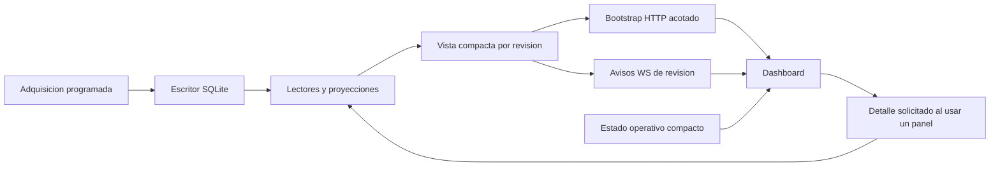

# Evaluación del arranque actual y plan posterior a las 24 horas

Estado: **diagnóstico; correcciones pendientes de implementación**. Se mantiene el backend en ejecución. No se han cambiado código, `.env`, trabajos, publicaciones ni datos de negocio durante esta evaluación.

## Ventana y fuentes verificadas

- Proceso: **PID 5858**, Node **v22.23.3**, inicio **21/10/2026 19:55:57 Europe/Madrid** (`2026-10-21T17:55:57.016Z`). El panel del agente usa `since=2026-10-21T17:55:57.827Z`; esa diferencia inferior a un segundo no cambia los trabajos incluidos.
- Corte del informe: **21/10/2026 20:27:46.614 Europe/Madrid** (`18:27:46.614Z`), unos **31 min 50 s** desde el inicio del proceso. Los acontecimientos posteriores quedan fuera de los recuentos.
- La escucha HTTP terminó de arrancar a las **19:58:25.542**; broker, OpenCode y worker quedaron iniciados entre **19:58:26 y 19:58:41**. El tiempo de arranque también pertenece a esta ejecución.
- Log activo: [shadow-backend-20261021-195556.log](../../../.agent-validation/shadow-backend-20261021-195556.log). Confirmado mediante el descriptor 3 del proceso `tee` **5843**, asociado al `npm start` actual. Su tamaño avanzó de **2.568.139** a **2.791.647 bytes** durante la revisión. No se leyó ni consumió el pipe de salida del backend.
- **No** se utilizó `backend/data/logs/ogid.log` como fuente actual: su última escritura corresponde al **18/10**.
- Lecturas GET de salud y estado administrativo; consultas SQLite cortas con `mode=ro` y `query_only=ON` contra **`/srv/bitcoin/ogid/db/ogid.sqlite`**; mensajes ya existentes de OpenCode, sin ejecutar prompts ni herramientas del modelo.
- Identidad: el backend arrancó desde el checkout `b8594d6…` con cambios locales; el HEAD al revisar es `0fc9da2…`. La huella de los archivos del backend en disco **coincide** con la capturada al arrancar: `ca6e53e8533e0cb4ea4028af12fbe78ab93116a8dae9292f0fc5f2ac65640549`. Esto permite contrastar el comportamiento con el código leído; el nombre del commit por sí solo no acreditaba esa coincidencia.
- Se consultó configuración sólo para localizar servicios y datos. `.env` permanece intacto. Las credenciales se usaron internamente y no se incluyen aquí, ni tampoco prompts, respuestas completas o cuerpos de noticias.

Las horas de las tablas siguientes son **Europe/Madrid, UTC+2**. Las líneas del log conservan fecha UTC. Las muestras de HTTP y SQLite no constituyen una transacción única entre todos los servicios.

## 1. Trabajos y publicaciones: resultado de este arranque

Al corte hay **6 ejecuciones iniciadas en este proceso: 3 completed, 2 failed y 1 waiting-model**. Las cinco terminadas necesitaron la única reparación permitida: **ninguna de esas cinco propuestas iniciales cumplió todos los requisitos**.

Hay **3 publicaciones nuevas y durables, todas shadow**, y **21 acumuladas**. Las tres corresponden a los tres trabajos completados; los dos fallidos no tienen publicación. La validación está impidiendo publicar propuestas inválidas, pero la conformidad inicial y la eficacia de la reparación requieren mejoras.

| Trabajo / instrumento | Fence | Inicio → fin | Duración total | Primera señal observada | Resultado y causa |
| --- | --- | --- | --- | --- | --- |
| `9f6dde95-af43-4a5b-bc7e-bfd46c10742a` / ASML.AS | 1 | 19:58:40 → 20:06:24 | 464,5 s | 255,3 s | **Completed**. Primer JSON sintácticamente válido, pero `/drivers/1/domain` fuera del enum. Reparación válida y publicación `84c4acf2-051e-44cf-ad30-f0b1cabb1649`. |
| `f03e074a-6e92-4dd3-b2e3-67caed087d15` / SPCX | 2 | 20:06:29 → 20:11:45 | 316,0 s | 106,3 s | **Failed / AGENT_INVALID_JSON**. Propuesta inicial con enum inválido y sin `intradayScenarios[0].evaluation`. La reparación terminó con JSON sintácticamente inválido. Sin publicación. |
| `5ebff72c-3d8d-4a77-ad77-a961d6b11c8b` / AMD | 1 | 20:11:46 → 20:16:14 | 267,9 s | 50,9 s | **Completed**. Primer `publish` rechazado con `AGENT_INVALIDATION_REQUIRED`; reparación con `direction=unavailable`. Publicación `8240380e-cb19-41ef-9821-8c0bd1a5971f`. |
| `4d3e5756-cdf2-45d1-9f94-2685e677a5fa` / ORCL | 1 | 20:16:14 → 20:21:51 | 336,7 s | 49,0 s | **Completed**. Mismo rechazo inicial; reparación mantuvo `direction=down` e incorporó una invalidación. Publicación `8614d448-42c6-4bf8-9ba1-5ebb12cf506e`. |
| `d7f99a12-d6f0-4d1a-bddc-41465e5826ef` / AAPL | 1 | 20:21:53 → 20:27:04 | 310,2 s | 99,8 s | **Failed / AGENT_UNVERIFIED_NUMBER**. La propuesta y la reparación citaron una ruta de objeto como si fuese numérica. Sin publicación. |
| `b1e3e783-b64b-4c3f-ba52-c93ef85c4fbe` / LMT | 1 | 20:27:04 → abierto al corte | 41,8 s al corte | Sin señal registrada aún | **Waiting-model**. No se clasifica como fallo. |

La duración total usa `started_at` y `finished_at`. `metadata.elapsedMs` se calcula antes de algunas confirmaciones y puede ser ligeramente menor.

Los acumulados al corte son `cancelled:1, completed:26, failed:139, incomplete:62, queued:22, superseded:109, waiting-model:1`. **Los 137 failed y 62 incomplete del texto inicial no eran nuevos errores de este arranque.** `superseded` tampoco significa rechazo de una publicación: es un estado de sustitución de trabajo.

### ASML.AS y SPCX: estructura inicial y reparación

Se validaron localmente los mensajes ya guardados con el esquema que está usando este backend:

- ASML.AS: el dominio de un driver no pertenece a `geopolitical | macro | sector | technical`. La reparación sí pasa el esquema. Este rechazo se produjo en el worker **antes** del HTTP `publish`; por eso no aparece como error de almacenamiento en el log.
- SPCX: además del enum, falta el campo obligatorio `evaluation` de un escenario intradía. La reparación final tiene **3.277 caracteres** y `JSON.parse` falla en posición **3276**, con contenido no blanco después del objeto. No es un timeout de SQLite ni una respuesta truncada por `finish=length`: OpenCode guardó `finish=stop`.
- El trabajo SPCX tiene también una ejecución anterior, fence 1, iniciada **antes** de este backend y reconciliada como incomplete a las 19:58:40. Se distingue del fence 2 fallido en esta ventana. El `error_code` actual de `agent_jobs` no debe atribuirse retrospectivamente a todos los fences anteriores.

**Corrección propuesta:** especializar el contrato de salida por tarea y transmitir mejor sus restricciones al modelo. Verificar soporte de salida estructurada en el recorrido real OpenCode → broker → llama.cpp: la prueba de capacidad de `modelCatalog` utiliza `response_format`, mientras que `OpenCodeClient.prompt()` entrega el contrato como texto. Que el catálogo anuncie `structuredOutput=true` no demuestra que cada respuesta del analista esté restringida por una gramática.

Conservar la validación final y el presupuesto único de reparación. No aceptar el primer fragmento JSON ni eliminar caracteres sobrantes indiscriminadamente para hacer pasar una propuesta ambigua. Registrar en forma acotada los errores de esquema y el resultado de la reparación, también cuando el rechazo ocurre antes de `publish`.

### AMD y ORCL: `AGENT_INVALIDATION_REQUIRED`

Los rechazos ocurrieron a las **20:14:36.850** y **20:20:30.421**, respectivamente. Ambos JSON declaraban `direction=down` y `invalidation=[]`. `assertPublication()` exige una invalidación no vacía para una perspectiva direccional de instrumento o mercado.

La reparación de AMD optó por abstenerse (`unavailable`), una salida permitida. ORCL aportó una invalidación y conservó la dirección. Ambos se publicaron después: **estos dos rechazos intermedios no son dos trabajos fallidos ni dos publicaciones perdidas**.

**Corrección propuesta:** expresar la condición dirección → invalidación en el esquema específico y ofrecer ejemplos mínimos coherentes. Conservar la posibilidad de abstención cuando faltan datos; nunca generar una invalidación desde el backend para sortear el control.

### AAPL: `AGENT_UNVERIFIED_NUMBER` repetido en la reparación

Dos rechazos: **20:25:45.882** y **20:27:00.772**, log líneas **5635** y **5773**. En ambos:

```text
evidenceId = analysis-702bda37c509ec9007c62f9ef0fb4b3d29100e63
path       = indicators.sma
reason     = numeric-path-not-found
```

La cifra entregada coincide con el dato congelado **337.60950164794923**. El problema es **la ruta**: `indicators.sma` es un objeto con `value`, `reason` y `sampleSize`; la cifra se encuentra en **`indicators.sma.value`**. El validador devuelve `expectedValue=null` porque el elemento señalado no es numérico, no porque falte la SMA.

El mensaje de reparación conservó las mismas rutas equivocadas. Hay otros hechos con rutas de indicadores que también necesitan comprobarse antes de publicar: corregir sólo el primero podría descubrir un segundo fallo.

**Corrección propuesta:** suministrar un catálogo acotado de rutas numéricas válidas de la evidencia consultada, con tipos, y devolver una indicación precisa para este error (`path apunta a objeto; ruta numérica disponible …`). Mantener la comparación exacta de cifras y validar todas las rutas. No relajar la comprobación ni convertir automáticamente objetos en hechos numéricos. Añadir un fixture de reparación que corrija `.value`, además de uno que confirme el rechazo si el modelo repite la ruta inválida.

## 2. El `AGENT_TASK_MISMATCH` mostrado pertenece al arranque anterior

Trabajo **`63860bd4-6a15-4db4-8d5b-a3dec8e868eb`**, fence **1**, snapshot **`26879dba-d289-4d37-9f37-80e151961776`**:

- Inicio **19:21:57.864**, fin **19:37:08.984**: terminó **18 min 48 s antes** del proceso actual.
- Duración registrada **910.947 ms** y primera señal **731.927 ms**, coherentes con los 911 s y 732 s del panel.
- El JSON sí tiene `task=instrument_outlook` e `instrumentId=yahoo-eunl-de-wk72py` correctos.
- La causa concreta es **`alertAssessments` con un elemento** dentro de una tarea `instrument_outlook`. `assertPublication()` también lanza `AGENT_TASK_MISMATCH` para esta combinación; ese bloque está reservado a `geopolitical_alert_assessment`.
- No hay mensaje de reparación en esa sesión. El código no incluye `AGENT_TASK_MISMATCH` entre los errores reparables.

**Corrección propuesta:** prohibir o limitar a cero `alertAssessments` para tareas ajenas a alertas en `publicationSchemaForJob()`, y devolver un diagnóstico distinto para «task incorrecta» y «campo exclusivo de otra tarea». Evaluar su inclusión en la misma reparación única, sin cambiar de tarea, instrumento, snapshot o evidencia para conseguir que se acepte.

La métrica «primera señal» **no mide el primer token de llama.cpp**. El worker la asigna cuando observa texto o herramientas en `opencode.progress()`. En esta sesión la primera ronda de asistente, previa a completar una herramienta, consumió aproximadamente **594 s** y registró **34.197 tokens de salida**. Esa ronda explica gran parte de la espera, además del trabajo previo al modelo; no demuestra 732 s de cola del broker. No se debe atribuir ese intervalo entero a SQLite ni extrapolarlo al arranque actual.

## 3. `AGENT_LEASE_LOST` de las 20:16:14: carrera con el cierre confirmado

La secuencia es comprobable en SQLite y el log:

| Hora | Evidencia |
| --- | --- |
| 20:15:54.326 | Heartbeat anterior, HTTP 200. La lease queda vigente hasta **20:17:24.183**. |
| 20:16:14.799 | AMD pasa a completed y se confirma su publicación durable. |
| 20:16:14.870 | HTTP `publish` termina con **200**, log línea **3985**. |
| 20:16:14.871 | Un heartbeat concurrente termina con **409 AGENT_LEASE_LOST**, líneas **3986–3988**. |

`fenced()` exige que el trabajo siga en running, validating o waiting-model. El heartbeat pendiente se procesa después de la publicación y encuentra **completed**, aunque todavía había tiempo de lease. El job no queda incomplete y la publicación se conserva.

**Diagnóstico:** carrera entre la renovación que ya estaba en vuelo y la finalización. En este caso no hay evidencia de una lease vencida por retraso de 90 s, pérdida de publicación o fallo del escritor. No justifica aumentar la duración de la lease.

**Corrección propuesta:** coordinar el cierre con las renovaciones ya enviadas y reconocer de manera explícita un cierre durable del **mismo job, owner y fence**. Mantener el heartbeat durante validaciones largas y rechazar siempre un owner/fence ajeno o una lease realmente vencida. Probar una renovación encolada detrás del commit y las variantes de vencimiento, sustitución y cancelación.

Hasta el corte hay **83 respuestas de heartbeat: 82 HTTP 200 y este único 409**, máximo observado **4.368 ms**. No hay un patrón observado de renovaciones agotando los 90 s.

La etiqueta «0 errores sin éxito posterior en la misma operación» tiene un alcance limitado: `StorageManager.activeErrors` se indexa por operación/método, **no por job/fence**. Un heartbeat exitoso de otro trabajo limpia ese indicador. No demuestra por sí solo que un trabajo fallido haya recuperado su resultado. Al corte hay **1** error de validación pendiente de éxito posterior en `publish`, el de AAPL, no una avería de SQLite.

## 4. `Health degraded`: hay que separar dos causas

### Marca `storage` envejecida artificialmente

En la muestra de **20:22:52**, el único pipeline en estado perjudicado era `storage: stale`, con último éxito a las **19:56:40.560**, razón `configure.completed` y sin error. Los tres workers estaban ready y había escrituras, adquisiciones y publicaciones posteriores.

`PipelineMonitor.snapshot()` convierte **cualquier** etapa completed en stale al superar diez minutos sin otro éxito. La configuración inicial de storage es una operación puntual; no se repite periódicamente. `healthController` degrada la salud si encuentra cualquier etapa stale. De ahí una alerta persistente aunque el almacenamiento continúe trabajando.

**Corrección propuesta:** distinguir etapas puntuales de etapas periódicas, con vigencia por etapa. La salud de SQLite debe usar estado, heartbeat, recuperaciones y fallos reales. No actualizar artificialmente el éxito de configuración en cada lectura de salud ni ocultar todas las etapas stale.

### Degradación SEC real añadida durante la revisión

La muestra de **20:27:46** ya incluye también `research.sec: degraded / SEC_SOURCE_UNAVAILABLE`, además de la marca de storage. Por tanto, corregir esa marca **no garantizaría** que la salud final fuese ok.

El estado persistido de `sec-alphabet-submissions` muestra:

- `status=error`, `failureCode=SOURCE_TRANSPORT_ERROR`.
- Intento **20:27:26.318**; último éxito **20:12:25.822**.
- Próximo intento elegible **20:32:29.816**.
- `sec-orcl-submissions` sí concluyó healthy en ese ciclo; se conservaron los datos anteriores de Alphabet.

No hay evidencia suficiente para atribuir ese fallo de transporte a un HTTP 403, a cuotas o a una configuración incorrecta del identificador SEC. No se lanzaron reintentos externos para investigarlo durante la observación.

**Corrección propuesta:** conservar backoff y datos previos; exponer por fuente la causa de transporte acotada y el resultado del siguiente intento. Si se repite, separar DNS, TLS, timeout y HTTP en la telemetría. No borrar la degradación real al arreglar la alerta de storage.

## 5. `REQUEST_TIMEOUT` y «Stale · últimos datos conservados»

Ese texto lo produce `SectionRefresh` en el navegador cuando una petición falla después de haber mostrado una respuesta válida. Conserva la tabla anterior; **no significa que se hayan borrado o rechazado los datos almacenados**.

Los plazos actuales no son iguales para todas las rutas:

- `/api/admin/news-raw`: **12 s**, plazo por defecto.
- `/api/admin/agent`: usa otro cliente con **15 s**.
- News y aggregate públicos: **185 s**; Conditions y Advanced: **275 s**.

En el log se completaron cinco peticiones de `admin/news-raw`, todas HTTP 200, en **10,33–11,34 s**. Ejemplos: líneas **1803/1805** a las 20:08:39 y **4093/4094** a las 20:16:48. El margen frente a los 12 s es de menos de un segundo en el caso peor, sin contar todo el transporte y consumo del JSON por el navegador. El endpoint vuelve a leer/clasificar el corpus para obtener una página.

**Lo probado:** existe un coste alto y un presupuesto estrecho para esa sección. **Lo no probado:** la petición concreta que agotó el plazo en el navegador del usuario. Las cinco respuestas registradas no superan 12 s; no corresponde inventar una correspondencia exacta. El logger registra `response.finish`, pero no deja un registro equivalente de todas las solicitudes abortadas antes de terminar. No se dispone de HAR ni del requestId del timeout mostrado.

**Corrección propuesta:** servir la página administrativa desde una proyección o caché acotada, compartir lecturas compatibles y paginar sin recalcular todo para cada sección. Añadir correlación de inicio, cierre prematuro y aborto con requestId, ruta y tiempos, sin cuerpos ni credenciales. Revisar el plazo específico con mediciones, evitando limitarse a incrementar globalmente los timeouts.

## 6. Intel News Raw, contadores y `Source: stale`

Los tres números describen conjuntos diferentes:

| Valor mostrado | Significado en el código actual |
| --- | --- |
| SQL candidates: 3931 | Candidatos del corpus de señales devuelto por `SqlNewsCorpus.getFeed()`, sujeto a clasificación y límites analíticos; no todo el archivo bruto. |
| selected: 100 | Selección editorial que se muestra en el snapshot; el límite de visualización es 100. |
| archive eligible: 7049 | Artículos elegibles de la ventana del corpus, antes de reducirlo a los candidatos de señales. |
| stored: 20:08:30 | Última ingesta conocida; no es la fecha de publicación periodística ni el éxito del último sondeo. |

No hay evidencia de que la diferencia **7049 → 3931 → 100** sea pérdida de noticias. El endpoint llamado Raw no representa un volcado sin filtros de todo el archivo. **Mejora propuesta:** aclarar esos rótulos y exponer ventana, límites y truncamiento, manteniendo separados archivo, candidatos y selección.

Se pudo contrastar la ingesta del texto del usuario con una proyección persistida:

```text
generatedAt                    20:09:02.535
lastIngestAt                   20:08:30.602
lastSuccessfulCheckAt          20:07:33.553
lastAcquisitionAttemptAt       20:07:33.279
latestGeopoliticalPublishedAt  19:58:53.000
sourceMode                     stale
```

El sondeo y la ingesta eran recientes, pero la noticia geopolítica más reciente ya superaba **10 minutos** de antigüedad. `SqlNewsPipeline.getProjection()` requiere tanto un chequeo vigente como una publicación reciente para marcar live; por eso puede marcar stale aunque haya escrituras nuevas. La proyección inicial de este proceso también era stale; otras posteriores fueron live. A las **20:22:52 y 20:27:46**, `/api/health` ya devolvía `sourceMode=live`.

El rótulo literal `Source: …` lo pinta el dashboard con `meta.sourceMode`. El resumen de Raw usa `sourceMode=sqlite-candidates` como identificación del conjunto consultado. **No son la misma medida**, aunque aparezcan juntas al copiar información del panel.

**Mejora propuesta:** mostrar por separado edad de publicación, éxito de adquisición, commit y recepción del panel; incluir una razón concreta para stale, como «última publicación geopolítica >10 min». No marcar live sólo porque se reingirió un artículo antiguo o se recibió un 304, ni presentar automáticamente esta situación como fallo del RSS legacy. No se ha cambiado el modo RSS ni `.env` en esta evaluación.

## 7. Otras señales de esta ejecución

- **Un vencimiento real de cola analítica:** `advanced.getSnapshot`, recibido a las **19:58:31.378**, agotó **90.001 ms en queued**, sin llegar a ejecutar. Consta en `lastExpiredCommand` y en la muestra del observador de las **20:00:34.515**. Se conserva separado del 409 del agente. No hubo recuperación ni caída de ese worker.
- **Carga al inicio:** el observador vio Conditions ejecutándose, un snapshot del agente activo y heartbeats de análisis atrasados unos **39–41 s**. El log recoge **43 avisos de SQL lento** hasta el corte; el máximo es **21.084 ms** en una consulta de eventos. También hay lecturas puntuales muy lentas durante el calentamiento. Esto acredita latencia y contención observada; no permite separar por sí solo CPU, I/O o caché del sistema.
- **Snapshots:** seis HTTP de snapshot, todos 200, máximo **154,6 s**. No se observaron recuperaciones de lectores en esta ventana. El primer snapshot fue mucho más lento que varios posteriores; no conviene aumentar concurrencia indiscriminadamente.
- **Conditions:** ocho respuestas observadas, todas 200, máximo **47,43 s**. Es una limitación de latencia aunque el plazo de 275 s permita completar la petición; no explica directamente el timeout de 12 s del Raw administrativo.
- **Cola del agente:** 22 trabajos pendientes al corte; el más antiguo se creó a las **18:09:55**, unas **2 h 18 min** antes de la muestra. Las ejecuciones terminadas muestran esperas desde creación de aproximadamente **135–150 min**. Hay deuda previa y poca capacidad efectiva con rondas largas y reparaciones. La antigüedad del job no equivale automáticamente a antigüedad de toda su evidencia: hay que comprobar el corte del snapshot.
- **Tres `AGENT_DEVICE_REQUIRED`, HTTP 401**, al consultar `/api/agent/v1/access` a las 20:03, 20:11 y 20:18. Son consultas de acceso sin dispositivo autorizado, no rechazos de publicación ni errores del modelo. Revisar su presentación como estado de autorización esperado, sin omitir la comprobación del dispositivo.
- Los cuatro HTTP 503 de readiness/admin-agent fueron **durante el arranque**, antes de que los componentes estuvieran preparados. No se clasifican como cuatro caídas posteriores del backend.
- El panel mezcla la fase final con el estado: `completed / repair` significa que terminó después de una reparación. Además, el bucle de reparación no actualiza todos los contadores de progreso como el inicial. Conviene mostrar intento, fase actual o última fase y resultado final por separado.

Los cinco `storage_command_failed` del corte corresponden a **dos invalidaciones, dos rutas numéricas y un heartbeat posterior al cierre**. Cada error puede aparecer además como `request_failed`: no deben contarse esas dos líneas como dos fallos de negocio independientes. Los rechazos locales de esquema/JSON sí necesitan otra fuente, pues no alcanzan a SQLite.

## 8. La observación de 24 horas no está completada

El observador existente [summary.json](../../../.agent-validation/shadow-24h-20261021-195630/summary.json) indica:

- Inicio **21/10 19:56:30.216**, fin **20:12:44.612**.
- `state=interrupted`, `completedObservation=false`, `requestedHours=24`.
- **17 muestras**, unos **16 min 6 s** contabilizados; aceptación `manual-review-required`.
- Cero recuperaciones de analysis y queries. Cuatro muestras con heartbeat retrasado; dos no disponibles y tres sin worker conectado incluyen la preparación inicial, por lo que requieren clasificación por fase.
- Su máximo de memoria RSS del backend fue **2.570.010.624 bytes**, y el WAL máximo **25.008.432 bytes** dentro de ese intervalo; no son máximos de 24 h.

El backend continuó vivo tras la interrupción del observador. No se ha reactivado el observador ni se ha creado una ejecución adicional del modelo en esta revisión.

Si se mantiene este proceso sin reinicios, las 24 h de uptime se cumplen el **22/10/2026 a las 19:55:57 Europe/Madrid**. Eso no completa retroactivamente las muestras que faltan. En la revisión posterior habrá que recuperar evidencia del log y SQLite y declarar los huecos de telemetría, o completar una nueva ventana de observación explícita. No se acredita estabilidad de 24 h ni se activa modo visible con este informe.

**Actualización posterior del operador:** hay un nuevo observador, iniciado el **21/10 a las 20:35:30.933**, PID **13586**, en `.agent-validation/shadow-24h-20261021-203530`. Se verificó en estado observing, sobre el mismo backend 5858. Su ventana de 24 h termina aproximadamente el **22/10 a las 20:35:31**, si continúa sin interrupciones. Esto no modifica el resultado interrupted del observador anterior. Tampoco cubre retroactivamente las conexiones del cliente analizadas en la sección 10, terminadas antes de su inicio. Esta ampliación documental no altera ninguna de las dos ejecuciones.

## 9. Plan de acción después de la ventana de 24 horas

Todas las filas están **pendientes**. Primero se cerrará la evidencia del mismo arranque; después se implementarán las correcciones y se validarán fuera de la ejecución observada.

| Orden | Cambio propuesto y archivos principales | Verificación de aceptación |
| --- | --- | --- |
| 1 | **Conformidad por tarea y reparación.** `backend/services/agent/worker.js`, `contracts.js`, `opencodeClient.js`; revisar el paso efectivo por broker. Separar campos exclusivos de alertas, condición de invalidación y rutas numéricas. Diagnósticos estructurales acotados, una única reparación y trazabilidad de su causa inicial/final. Versionar el prompt si cambia el contrato de ejecución. | Fixtures de ASML, SPCX, EUNL, AMD, ORCL y AAPL. Rechazo persistente sin publicación si la reparación continúa inválida; publicación correcta y única cuando cumple. No cambiar tarea, instrumento ni snapshot para hacer pasar el resultado. Medir conformidad inicial y reparación en shadow por separado. |
| 2 | **Carrera de heartbeat con finalización.** `worker.js`, `backend/storage/agentRepository.js`. Coordinar cierre y renovación, conservando el control por owner/fence y la comprobación al commit. | Reproducir heartbeat pendiente tras publicación durable del mismo fence sin falso fallo. Debe seguir rechazando owner/fence incorrectos, lease vencida y trabajo cancelado. Sin duplicados ni ampliación ciega de lease. |
| 3 | **Salud por naturaleza y frecuencia de etapa.** `backend/services/pipelineMonitor.js`, `backend/controllers/healthController.js`, registro de storage. | Tras más de diez minutos, un configure puntual completado no degrada por edad; sí se detectan worker caído, heartbeat realmente vencido, etapa periódica obsoleta y la degradación SEC independiente. |
| 4 | **Lecturas administrativas y expiración analítica.** `backend/controllers/adminController.js`, `backend/storage/sqlNewsCorpus.js`, `StorageManager.js`, coordinadores de Advanced; `frontend/js/api.js`, `adminRefresh.js`. Compartir/persistir resultados acotados, evitar lectura y ranking completos por cada página, revisar espera analítica y prioridades. | Verificar páginas y filtros correctos, métricas comparables antes/después, margen frente al plazo administrativo y tratamiento explícito si no hay resultado fresco. Reproducir arranque con Conditions + Advanced + snapshot sin expirar la cola ni bloquear adquisición/heartbeats. No resolverlo sólo aumentando todos los plazos. |
| 5 | **Panel y correlación de errores.** `frontend/js/agentOperationsView.js`, `workerOperations.js`, `admin.js`, `dashboard.js`; `backend/utils/logger.js`, estado de runs. Separar arranque/histórico, intentos de publicación/publicaciones durables, fase final/estado y errores por job/fence frente a errores por operación. Registrar abortos HTTP de forma acotada. | Un rechazo reparado no se presenta como pérdida de publicación; un fallo local de esquema es visible; un éxito de otro job no se interpreta como recuperación del fallido. Timeout del navegador correlacionable sin registrar cuerpos ni secretos. |
| 6 | **Cola y coste de generación.** Planificación en `agentRepository.js`, worker y métricas del broker. Evaluar coalescencia de trabajos automáticos obsoletos, prioridades y estado de espera; distinguir cola, snapshot, modelo, herramientas, validación y reparación. | Medir edad pendiente y resultados por tarea/modelo, conservar trabajos interactivos y el comportamiento determinista. No limpiar la cola manualmente ni subir concurrencia sin medir memoria y latencias. «Primera señal» debe nombrar lo que realmente mide. |
| 7 | **Fuente SEC y continuidad de observación.** `backend/services/research/secSourceAgent.js` y adquisición oficial; `backend/scripts/agent-shadow-observe.js` si necesita continuidad/reanudación explícita. | Determinar el resultado del siguiente intento de Alphabet y la clase concreta si falla; respetar cooldown. Evidencia de observación con PID, arranque, huecos y estado final explícitos; ningún resumen interrumpido se acepta como 24 h completadas. |
| 8 | **Entrada del cliente y sincronización.** Aplicar las etapas S1–S3 detalladas en la sección 10: corregir conservación/recuperación de revisiones, ajustar el tamaño HTTP y añadir una vista inicial compacta con detalles bajo demanda. | Reducir peticiones con datos y calidad equivalentes, resolver el caso reproducible de los 67 conflictos de pipelineStatus y respetar presupuestos de memoria, frescura y cola. Medir por navegación y por sesión; mantener compatibilidad con v2. |

Al cerrar la ventana se compararán **fences y ejecuciones iniciadas desde este arranque**, propuestas rechazadas antes/después de reparación, publicaciones nuevas, edad de la cola, expiraciones, recuperaciones, heartbeats, latencias, RSS y WAL. Se conservarán las causas históricas y los éxitos posteriores sin mezclar ambos recuentos.

Las pruebas posteriores deben centrarse en estos comportamientos y usar una copia consistente cuando requieran carga o escritura. Se mantiene la base principal en `/srv/bitcoin`, llama.cpp y el arranque exclusivo con `cd backend && npm start`, con broker/OpenCode/worker como hijos y sus interruptores actuales. Este documento no programa reinicios ni implementación automática al cumplirse la hora.

## 10. Estudio de entrada del cliente y resolución de conflictos de revisión

Ampliación solicitada después del diagnóstico inicial. **Sólo diseño e investigación; ninguna mejora de runtime de esta sección está implementada.** La evidencia del cliente corresponde al mismo arranque y a la ventana **20:03:07–20:34:39 del 21/10**, separada del corte inicial de las secciones 1–9.

### 10.1. ¿Son necesarias las 4.596 peticiones?

**No todas son necesarias para presentar la información útil.** Tampoco son 4.596 peticiones de una única apertura: incluyen **cuatro aperturas del dashboard, dos navegaciones a Admin y las actualizaciones mientras el cliente estuvo usando esas páginas**. La arquitectura requiere adquisición independiente, una primera lectura y posteriores actualizaciones; no requiere fragmentar esta vista en cientos de viajes HTTP ni repetir una consulta de manifiesto que ya viene en el error.

Desglose verificado para `192.168.1.48`:

| Clase | Peticiones | Lectura del resultado |
| --- | ---: | --- |
| Páginas de recursos sync, HTTP 200 | 3.919 | Datos útiles, pero fragmentados en unidades de sólo 8.000 caracteres. |
| Páginas sync rechazadas con 409 | 67 | Todas `pipelineStatus`, cursor 0; requieren corregir la carrera de revisión. |
| Manifiestos sync | 71 | Cuatro iniciales y 67 consultas adicionales tras los conflictos. |
| Otras rutas API | 409 | Noticias, Conditions, Advanced, consultas administrativas, autorización, etc.; revisar necesidad por panel y revisión. |
| Documentos, JavaScript, CSS e imágenes | 130 | Incluye las cuatro aperturas y Admin; varios recursos ya utilizan 304. |
| **Total** | **4.596** | **4.057 sync, el 88,3 % del tráfico contado por solicitudes.** |

La sincronización de datos funciona mediante avisos WebSocket pequeños y recuperación HTTP. Se observaron 343 mensajes WebSocket y aproximadamente 112,5 KB, frente a unos **34,7 MB de JSON contabilizados por sync**, sin que ese contador equivalga a bytes reales de red comprimidos. No hay evidencia de que los avisos WebSocket estén transportando todo el corpus.

| Recurso sync | Revisiones leídas con éxito | Páginas 200 | Máximo de páginas por revisión |
| --- | ---: | ---: | ---: |
| market | 9 | 2.094 | 236 |
| meta | 17 | 824 | 49 |
| awareness | 13 | 325 | 25 |
| news | 11 | 286 | 26 |

Los cursores avanzan; no se encontró repetición de la misma página para esas revisiones. El coste se concentra en descargar **cada representación completa**, especialmente market, y en iniciar paneles/consultas que podrían esperar a su uso.

No se ha medido la distribución por campo del market vivo. El archivo de snapshot de mercado leído durante el estudio tiene unos 28 KB y no contiene toda la representación sincronizada: no sirve para atribuir los 1,9 millones de caracteres a un campo concreto. Antes de retirar datos hay que medir en la proyección real cuánto ocupan series, diagnósticos y otros campos y qué componentes los consumen.

**Decisión:** reducir primero páginas y recuperaciones evitables, después reducir el contenido del arranque mediante una proyección explícita. Conservar los datos completos en sus rutas de detalle y su procedencia; no ocultar errores ni recortar contratos silenciosamente para cumplir una cifra de peticiones.

### 10.2. Causa precisa de los 67 conflictos

La revisión del código identifica una carrera más específica que «TTL de un minuto demasiado corto»:

1. El servidor anuncia la revisión de `pipelineStatus` mediante el manifiesto/WS.
2. `StateSync.change()` serializa el estado nuevo y sobrescribe `this.serialized`.
3. Al cambiar la revisión sólo conserva la anterior si existe en **`this.cache`**. Ese cache se llena cuando alguien solicita una página. Una versión anunciada que todavía no se ha leído puede desaparecer sin haber llegado al límite de 60 s.
4. El navegador puede encontrarse descargando otros recursos. Al pedir después la primera página de una revisión ya sustituida, recibe `SYNC_REVISION_EXPIRED`.
5. `getSyncSnapshot()` ya incluye el manifiesto actual en **`error.details`**, y `api.request()` conserva esos details. Sin embargo, `StateSynchronizer.sync()` hace otro GET para pedir ese mismo manifiesto.

Los 67 conflictos son todos de `pipelineStatus`, cursor **0**. No se trata en esta evidencia de una página 200 seguida por pérdida de sus siguientes fragmentos. El epoch fue el mismo; el backend no se reinició entre esas conexiones.

El frontend **ya** tiene una descarga compartida por pestaña y conserva recursos completos al recuperar un 409. También toma `this.target[resource]` al comenzar cada recurso; no fija de una vez todas las revisiones al principio. Debemos conservar esas propiedades. Cambiar sólo el orden de los recursos o añadir más paralelismo no elimina la carrera entre el aviso y la primera lectura.

### 10.3. S1: corrección compatible del protocolo v2

Primera implementación propuesta, sin cambiar las formas públicas de los recursos existentes:

**Servidor — conservar correctamente el estado anterior.** En `backend/websocket/stateSync.js`, obtener la representación anterior desde cache **o desde el serializado de esa revisión antes de sobrescribirlo**, y moverla al historial sólo si el contenido cambió. Registrar su identidad `(epoch, resource, revision)` y su vencimiento. No devolver el contenido nuevo rotulado con una revisión antigua. Usar una única entrada de representación y referencias cuando cache/serializado/historial apunten al mismo contenido; medir el presupuesto total, no sólo `retainedBytes`.

La retención continuará acotada por bytes y antigüedad. Añadir reparto por recurso o reserva para las representaciones en curso, para que el estado operativo cambiante no desplace una descarga de mercado. **Retener todo durante 60 s no es una garantía ilimitada:** también existen presión de memoria y límite de entradas. Esas expulsiones deben tener causa y métrica explícitas. Bajo presión excepcional se conservará el último resultado completo y se recuperará de forma acotada; no se aumentará indefinidamente la memoria.

**Cliente — aprovechar la respuesta existente.** En `frontend/js/stateSync.js`, validar el manifiesto de `error.details` y pasarlo al sincronizador sin otro GET. Comprobar protocolo, epoch y tipos de revisiones. Cuando un servidor antiguo no entregue un manifiesto válido, permitir una única consulta de recuperación compartida. Esto elimina **un GET adicional por conflicto** en el recorrido actual; no elimina por sí solo el conflicto original.

**Recuperación localizada.** Conservar los recursos ya completos y su revisión, descartar sólo los fragmentos incompletos del recurso afectado y evitar reiniciar el bootstrap entero. Tras dos conflictos inmediatos del mismo recurso, aplicar espera con jitter entre 250 ms y 2 s para ese recurso. El estado operativo pendiente no debe bloquear la aplicación de noticias/mercado completos. Registrar fin de recuperación y detener el reintento al ocultar/cerrar la página; no convertir el caso en un bucle sin pausas.

**Publicación de estado operativo.** Agrupar avisos ordinarios de pipeline hasta una frecuencia máxima inicial de **1/s**, con cambios a failed/blocked/degraded y recuperación enviados con prioridad. Los contadores de ejecución y marcas de muestreo se consultarán en Admin; no deben obligar a republicar todos los recursos del dashboard. El agrupamiento no debe modificar el trabajo de los pipelines ni hacer desaparecer el diagnóstico de un fallo.

**Pruebas que faltan:** el test existente de invalidaciones frecuentes termina tras la primera actualización completa de news; no acredita que `pipelineStatus` converja después. Añadir el caso «revisión anunciada, nunca paginada, sustituida antes de la primera página», y una prueba que espere la convergencia de ambos recursos sin cerrar anticipadamente el cliente.

### 10.4. S1: reducir fragmentación HTTP sin ampliar los mensajes WS

Probar páginas de **hasta 64 KiB de cuerpo JSON HTTP codificado en UTF-8**, en vez de 8.000 caracteres de fragmento. El presupuesto incluye la envoltura, el escape de comillas, barras y controles, no sólo la longitud de la cadena original. Mantener límites de tiempo y cancelación.

El cliente ya sigue `nextCursor`; no depende de que avance exactamente 8.000. La implementación debe conservar el significado de cursor de v2 y cortar en límites que no dañen Unicode. Si se introduce un cursor en bytes, tendrá una versión de codificación distinta y negociación explícita. No se cambian los límites de 64 KiB de WebSocket, 8 MiB de comandos SQLite ni las colas de los workers por este ajuste HTTP.

**Estimación aritmética, no benchmark:** manteniendo las mismas 285 combinaciones recurso/revisión leídas, agrupar ocho fragmentos actuales por página daría aproximadamente **707 páginas 200 frente a 3.919**, un 82 % menos en ese grupo. Manteniendo artificialmente todo lo demás igual, serían unas **1.384 solicitudes totales frente a 4.596**, cerca de un 70 % menos. No incorpora escape/UTF-8 ni la interacción de nuevos tiempos con las revisiones; no se ofrece como rendimiento conseguido. La página limitada por bytes se medirá con el JSON real.

Aumentar páginas reduce viajes, pero no los megabytes transmitidos ni el coste de preparar una representación grande. Por eso S2 sigue siendo necesario. La compresión HTTP, si las mediciones justifican añadirla, será una optimización de bytes con caché por revisión y ejecución asíncrona; no se contabilizará como reducción de solicitudes. Node.js documenta el coste de serializaciones grandes y la necesidad de mantener breves las tareas del event loop. [Guía oficial de Node.js](https://nodejs.org/en/learn/asynchronous-work/dont-block-the-event-loop#blocking-the-event-loop-json-dos).

### 10.5. S2: vista inicial compacta, detalles bajo demanda

Diseño recomendado dentro de la arquitectura actual: **proyección de lectura para el dashboard**, con contrato versionado y negociación de capacidad, conservando v2 para clientes anteriores. La vista compacta no sustituirá silenciosamente el objeto market completo que espera un cliente v2.

Propuesta de entrada: `GET /api/intel/bootstrap?profile=dashboard-v1`, anunciado sólo cuando esté disponible en capabilities. Devuelve una envoltura compacta, con un presupuesto inicial de **128 KiB sin comprimir**. Es un objetivo de diseño para datos visibles, no una respuesta ilimitada que agregue todos los endpoints.

| Información | Se carga al entrar | Se difiere hasta utilizar el panel |
| --- | --- | --- |
| Metadatos | Epoch, revisiones, filtros efectivos, fechas, modo/calidad, cobertura y motivos de stale. | Catálogo RSS completo, trazas de proveedores y diagnósticos por fuente. |
| Noticias | Primera página visible con identidad y campos que usa su tarjeta, conservando orden y procedencia. | Páginas siguientes, archivo antiguo y detalle de cada noticia. |
| Países/mapa | Campos necesarios para pintar el mapa y riesgos visibles. | Desgloses y series de un país cuando se selecciona. |
| Mercado | Cotizaciones de la selección activa, identidad, moneda, sesión, fechas y calidad. | Histórico por instrumento, velas y explicación técnica; separar la serie de la revisión de quotes. |
| Awareness | Resumen de cobertura y próximos elementos visibles. | Agenda completa y filtros especializados. |
| Conditions / Advanced | Resultado durable disponible o estado preparing con su revisión/dependencias. | Cálculo/lectura de detalle sólo cuando el panel visible lo necesita; sin espera obligatoria del bootstrap. |
| Agente | Capacidades y modo efectivo suficientes para mostrar su disponibilidad. | Modelos, dispositivo, sesiones y chat al abrir el analista; resultados públicos sólo si su modo los permite. |
| Operación | Resumen pequeño de salud/pipeline. | Colas y diagnóstico completo de Admin, conforme a autorización existente. |

Cada campo retirado del arranque debe tener un consumidor identificado y un camino de detalle probado. Hay controles que usan `meta.sourceMeta.corpus`, `market.timeseries` y cobertura: se migrarán a la proyección y a sus dependencias declaradas, no se eliminarán sin reemplazo.

El bootstrap se construirá a partir del estado/proyecciones ya calculados, con caché acotada por revisión semántica, perfil y filtros. No disparará RSS, proveedor de mercado, modelo o mantenimiento por conectar un navegador. Se conservará SQLite como fuente durable, el escritor único y los lectores actuales. Los endpoints de detalle usarán datos almacenados; una adquisición forzada seguirá requiriendo la acción existente del operador.



**Frescura y coherencia.** La clave de la vista incluirá las revisiones reales de sus entradas, identidad de instrumentos, filtros y esquema. No se publicará una combinación de resultados calculados con dependencias diferentes como si tuviera un único corte consistente. Un grupo analítico relacionado se aplicará completo o se conservará su versión anterior; recursos independientes pueden actualizarse por separado, mostrando sus fechas. El paso del tiempo debe actualizar la etiqueta de antigüedad sin retransmitir históricos completos, respetando los umbrales de obsolescencia.

### 10.6. S2: separar pipelineStatus del flujo paginado pesado

Para el nuevo perfil, **pipelineStatus deja de ser un recurso cuya descarga retrase o reinicie la vista de negocio**. Se propone un resumen operacional independiente:

- Incluido en el bootstrap para la primera pintura.
- Actualizaciones por un evento pequeño y versionado, por ejemplo `pipeline:status:v1`, con epoch, secuencia y estados/códigos/fechas acotados. Presupuesto inicial **16 KiB por mensaje**, dentro del límite WS actual.
- Envío de la última imagen compacta con coalescencia, hasta 1/s para cambios ordinarios. Fallos y recuperación mantienen prioridad y diagnóstico durable separado.
- El cliente aplica sólo secuencias nuevas del mismo epoch y no necesita paginar este resumen. Al reconectar recibe el estado actual. El historial de incidentes se sigue consultando en Admin/log, no en esta imagen reemplazable.

Esto retira la causa concreta de los 67 conflictos del flujo nuevo. Los clientes v2 conservan su recurso y reciben la corrección S1. Se versionarán mensaje, capacidades y proyecciones; no se activará un evento desconocido como requisito para un frontend antiguo.

Para recursos grandes diferidos se mantendrá la consistencia por revisión. La referencia de arquitectura es una paginación que conserva el mismo snapshot entre páginas, una propiedad documentada, por ejemplo, en la API de Kubernetes; se adopta esa propiedad, no su infraestructura ni sus códigos HTTP. [Documentación oficial de paginación consistente](https://kubernetes.io/docs/reference/using-api/api-concepts/#retrieving-large-results-sets-in-chunks).

**Admisión y fijación de la representación:** al aceptar la primera página se fija su `(epoch, perfil, filtros, recurso, revision)` y se devuelve un identificador de descarga, vencimiento absoluto y cursor. Las continuaciones leen exactamente esa representación inmutable, con un máximo inicial de 60 s, sin prolongar la reserva en cada petición. Cada reserva cuenta en el presupuesto global; no habrá un cache de 64 MiB por cliente. Antes de aceptar una descarga que no quepa, se devuelve falta de capacidad con espera/reintento acotado; una descarga aceptada no se desaloja silenciosamente para admitir otra.

En el perfil nuevo, el aviso WS puede ser una indicación de revisión mínima: la primera página elige y devuelve una revisión actual no menor a la requerida. Esa semántica debe estar declarada y comprobada por el cliente. **Las continuaciones y los pedidos exactos v2 nunca cambian a latest implícitamente.** El token es una referencia de lectura, no una autorización; se conservan perfil, filtros y controles de acceso. Expiración, cambio de epoch y falta de capacidad se diagnostican por separado.

### 10.7. S2: coordinar quién solicita datos y cuándo

Hay optimizaciones existentes que deben aprovecharse: `StateSynchronizer` ya serializa la descarga por pestaña, `SmartPollLoop` evita solaparse consigo mismo y adapta la frecuencia con visibilidad, y news mantiene una clave de lectura por revisión/filtros. El problema no se resuelve añadiendo otro temporizador o un segundo coordinador paralelo.

Cambios concretos propuestos:

1. **Un propietario del arranque.** `bootstrap()` crea el sincronizador y los módulos en modo hidratación. Bootstrap HTTP y `ws:ready:v2`/nueva capacidad comparten la misma operación inicial; no inician dos recorridos de carga. Watchlist se obtiene una vez y se comparte.
2. **Distinguir transporte disponible de vista sincronizada.** El fallback actual usa `wsConnected`, que depende también de `wsHasSnapshot`; un episodio syncing puede reactivar el polling aunque el socket esté sano. Usar estados explícitos conectando/sincronizando/listo/reconectando/obsoleto y un plazo de progreso. El fallback actúa si falla el transporte o se agota ese plazo, compartiendo la operación en curso, sin añadir una consulta cada 15 s mientras la descarga progresa.
3. **Hidratación reutilizable.** Si la primera página de news satisface país, límite, orden, ventana y revisión de la vista, no volver a pedirla de inmediato en `refreshStoredLiveNews()`. Conservar GET cuando el filtro o contrato de lectura sea diferente. Aplicar el mismo criterio a quotes, watchlist y al resumen Awareness.
4. **Carga por interés.** Abrir/cerrar panel, cambio de filtro y entrada en viewport son señales para cargar detalles. La API Intersection Observer entrega información de visibilidad asíncrona; usarla como señal de interés, con controles explícitos para paneles y navegación por teclado. No basta con ocultar HTML mientras se siguen lanzando las consultas. [Especificación W3C](https://www.w3.org/TR/intersection-observer/).
5. **Claves y descargas compartidas.** Una petición por `(dominio, filtros normalizados, revisiones, esquema)`; consumidores equivalentes comparten su Promise. Al abandonar una vista se cancela su interés y se ignoran resultados de una generación previa; una cancelación no debe invalidar el resultado que otro consumidor todavía necesita. No compartir entre filtros, perfiles o autorizaciones incompatibles.
6. **Invalidaciones semánticas.** Conditions se invalida por sus dependencias declaradas de noticias/mercado/Awareness/filtros; Advanced por las suyas. Un contador de pipeline o un timestamp de muestreo no dispara esos cálculos. Mantener el último resultado completo mientras el trabajo durable se prepara y respetar `retryAfterMs` o su evento de disponibilidad.
7. **Presupuesto de concurrencia.** Primero compactar y corregir revisiones; después probar un máximo de dos lecturas independientes por pestaña, con una sola analítica pesada en curso. No paralelizar cientos de páginas con `Promise.all` ni sustituir la cola SQL por una cola ilimitada en el navegador. Compartir representaciones cacheadas entre clientes en el servidor.
8. **Ciclo de vida.** Mantener cancelación en pagehide, reanudación bfcache y reducción en pestaña oculta. Al volver, validar epoch y revisiones antes de reutilizar el estado. Las APIs de visibilidad son parte del estándar HTML. [WHATWG: Page visibility](https://html.spec.whatwg.org/multipage/interaction.html#page-visibility).

La autorización de dispositivo no se omitirá para reducir cuatro 401: se comprobará cuando se abra la funcionalidad que la requiere, reutilizando el resultado hasta que cambie su estado. El modo shadow no debe provocar consultas periódicas de publicaciones públicas que el propio backend oculta, salvo que una vista administrativa las esté solicitando.

### 10.8. S3: caché HTTP y frecuencia de refresco

`ETag` e `If-None-Match` permiten validar una representación y responder 304 cuando no cambió. **Eso reduce cuerpo y trabajo si se compara antes de calcular, pero sigue siendo una solicitud HTTP.** Las 220 respuestas 304 observadas no equivalen a 220 fallos ni son el objetivo principal de reducción. [RFC 9110, sección 13.1.2](https://www.rfc-editor.org/rfc/rfc9110.html#section-13.1.2).

Para lecturas cacheables del nuevo perfil, proponer validadores de representación que incluyan epoch, perfil, selección, esquema y revisión semántica. Si la codificación cambia sus bytes, debe reflejarse en el validador/variación correspondiente. Respuestas específicas del operador utilizarán cache privado y la política de autorización actual; no se compartirá un resultado administrativo con clientes públicos.

Elegir `private, no-cache` cuando se permita conservar y validar la representación, y `no-store` cuando no deba guardarse. No usar no-store y esperar a la vez reutilización normal del cache HTTP. El cliente conservará el cuerpo válido al recibir un 304 explícito y no intentará parsear un cuerpo ausente; si deja la validación al cache del navegador, probar ese recorrido real. Estas directivas tienen semánticas diferentes. [RFC 9111, cache-control](https://www.rfc-editor.org/rfc/rfc9111.html#section-5.2.2).

Con WebSocket sano y una revisión ya aplicada, no hay que volver a consultar la misma representación sólo porque haya transcurrido un temporizador de otro módulo. Mantener una comprobación de frescura y recuperación acotada, además de los eventos. Los resultados paginados que dependen de una reserva temporal conservarán no-store salvo que su contrato de cache se diseñe expresamente: un 304 de una página no prolonga la reserva del servidor.

Admin conservará telemetría de workers a 5 s mientras sea visible si resulta necesaria; las 87 peticiones de runtime observadas son coherentes con ese uso. La optimización será detener paneles sin interés y compartir datos que ya existen, no ocultar eventos ni aumentar indiscriminadamente los intervalos de diagnóstico. No se necesita introducir un framework, Redis, otra base de datos o un servicio adicional para estas medidas.

### 10.9. Instrumentación para evaluar estabilidad y beneficio

No basta con contar solicitudes o ver HTTP 200. Medir, por navegación y por intervalo comparable:

- Total HTTP y API, páginas por recurso/revisión, bytes JSON, bytes transferidos, 304, abortos, manifiestos y conflictos clasificados por recurso/fase/causa.
- Inicio de navegación → primera vista útil → convergencia de recursos críticos. Anotar filtros, epoch, versión de frontend, cache frío/caliente, número de pestañas y clientes.
- Tiempo de servidor y TTFB/descarga del navegador por separado. Resource Timing expone fases y tamaños; completar con marcas de aplicación para saber cuándo se aplicó y pintó la vista. [Especificación W3C Resource Timing](https://www.w3.org/TR/resource-timing/).
- CPU, RSS, retraso del event loop, bytes y tiempo de serialización/compresión, cache actual/histórico/reservado, admisiones rechazadas y razón de expulsión.
- Cola y ejecución de escritor/lectores; edad de heartbeats; expiraciones y recuperaciones; revisiones/fechas realmente mostradas; progreso de adquisición, jobs y publicaciones durables.

Reutilizar `RuntimeMetrics`, `StateSync.metrics` y la ruta administrativa existente con contadores/buffers acotados. El logger principal sólo registra finish; `RuntimeMetrics` también observa close, pero sus agregados no permiten atribuir todas las cancelaciones a una ruta o recurso. Añadir esa correlación sin registrar cuerpos, cookies ni credenciales. Un resumen por navegación/recurso evita necesitar una traza detallada permanente de cada fragmento.

El observador actual muestrea cada minuto salud, readiness y agente. Conserva recuentos y métricas WS numéricas, pero **no** la distribución de `/sync` por IP/recurso, los motivos de cada 409 o el coste de pintar el navegador. Una mejora posterior del observador añadirá contadores agregados de sync y disponibilidad de la vista, manteniendo los ficheros originales y la identificación del arranque; no se modificará el observador que está ejecutándose para recogerlos.

### 10.10. Secuencia de entrega, pruebas y objetivos

Las cifras siguientes son **criterios propuestos para validar**, no resultados de una implementación realizada:

| Etapa | Entrega | Objetivo verificable |
| --- | --- | --- |
| S0, después de cerrar la observación | Capturar una línea base de navegación y tamaños por campo, con fixtures saneados y métricas ya disponibles. | Separar cuatro aperturas, Admin y polling. El log permite reproducir secuencias de URLs y tiempos, no reconstruir todos los cuerpos/versiones que no guardó. No llamar replay exacto a una simulación. |
| S1 | Conservar versión anterior no leída, usar manifiesto del error, recuperación localizada, páginas HTTP acotadas más grandes. | Cero 409 en la prueba determinista de cambio de pipeline antes de su primera lectura; cero GET adicional si el error trae manifiesto válido. Reducir al menos **60 %** las solicitudes en una carga equivalente a la línea base sin alterar datos. |
| S2 | Bootstrap/proyecciones compactas, resumen operacional separado y detalles por interés con descargas consistentes. | **Hasta 20 peticiones API en los primeros 10 s** del dashboard estándar, sin abrir detalles, frente a unas 350 de sync actuales. Bootstrap ≤128 KiB; cero consulta de históricos/modelos para paneles cerrados. Vista útil p95 ≤3 s en la LAN de prueba. |
| S3 | Cache condicionado, control por revisión y presupuesto de carga en uso sostenido. | Buscar **≥80 % de reducción API** en un recorrido comparable con los mismos paneles, datos y frescura. El objetivo se acepta sólo si no empeoran heartbeats, cola, errores, event loop y memoria fuera del ruido medido. |

Condiciones de corrección y escenarios obligatorios:

1. Revisión de pipeline anunciada y sustituida antes de su primer GET; avisos continuos mientras market se pagina; convergencia final de todos los recursos interesados.
2. Cambio a mitad de una descarga, expiración real, presupuesto de cache agotado y reinicio de epoch. Nunca mezclar fragmentos de dos versiones ni marcar aplicado un recurso incompleto.
3. Error 409 con manifiesto válido, ausente o mal formado; conflictos repetidos de un único recurso. Verificar que los recursos completos se conservan y no hay bucle inmediato ni descarga global repetida.
4. UTF-8, caracteres suplementarios, comillas, controles y fragmentos en límite. Comparación profunda del resultado original y reconstruido y del cuerpo codificado contra el límite efectivo.
5. Perfil nuevo con servidor anterior y cliente v2 con servidor nuevo; capacidades y errores de parámetros explícitos. No cambiar la forma de un recurso por debajo de un consumidor antiguo.
6. Entrada fría/caliente, volver de Admin, dos pestañas, dos clientes con filtros distintos, bfcache, pestaña oculta y desconexión/reconexión. Ningún resultado de la selección anterior debe sobrescribir la nueva.
7. Verificar los mismos IDs, orden, precios, intervalos, fechas, modos y calidad que antes; detalle e históricos accesibles cuando se solicitan. Una reducción de solicitudes que oculta información requerida no pasa la prueba.
8. Base consistente en una ejecución de validación posterior, carga controlada de 1, 2 y 5 clientes y la adquisición de fondo representativa. Verificar que una entrada de cliente no inicia proveedor/modelo ni trabajos de negocio adicionales. No ejecutar esta carga en el proceso de observación actual.

No hacen falta pruebas nuevas para validar que este Markdown se guardó; las anteriores son las pruebas de comportamiento de la implementación futura. Medir p95 con una muestra suficiente y conservar máximos y distribución; no convertir una sola apertura rápida en garantía de estabilidad.

### 10.11. Mapa de implementación y compatibilidad

| Área | Archivos principales | Responsabilidad de la modificación futura |
| --- | --- | --- |
| Versiones y recursos | `backend/websocket/stateSync.js`, `backend/tests/stateSync.test.js` | Conservación previa al reemplazo, métricas, presupuestos, UTF-8 y descargas consistentes. |
| HTTP y contrato de vista | `backend/controllers/intelController.js`, `backend/routes/intelRoutes.js`, `backend/contracts/ogidOperations.js`, capacidades | Bootstrap y perfil explícitos, límites y errores; actualización del inventario API/MCP y versión de contrato cuando corresponda. |
| Proyección | `backend/state/stateManager.js` y un proyector específico de dashboard si simplifica el código | Selección de campos desde lecturas existentes, sin cambiar el estado de negocio ni la escritura SQLite. |
| Transporte WS | `backend/websocket/socketServer.js`, `boundedTransport.js` | Avisos existentes y resumen operacional pequeño, prioridades y coalescencia dentro del presupuesto actual. |
| Sincronizador | `frontend/js/stateSync.js`, `frontend/js/api.js` | Recuperación desde details, generaciones, negociación, cancelación y límites por recurso. |
| Entrada y paneles | `frontend/js/dashboard.js`, `awareness.js`, `agentIntelligence.js`, `intelligence/advancedIntelligence.js`, `smartPollLoop.js` | Hidratación, carga por interés, claves compartidas y dependencias de refresco, preservando filtros y bfcache. |
| Diagnóstico | `backend/services/runtimeMetrics.js`, `backend/utils/logger.js`, Admin y observador | Atribución y contadores acotados, comparación de coste/frescura y observación posterior. |

Se entregará por etapas revisables: S1 compatible, después capacidad del perfil nuevo y migración del cliente con fallback v2. Ante una regresión se desactiva la capacidad nueva y se vuelve a v2; no se borra información ni se modifica la base para revertir una optimización de lectura. La adquisición, SQLite de `/srv/bitcoin`, llama.cpp, controles de hijos en `.env` y el arranque con `npm start` permanecen dentro de la arquitectura acordada.

Las referencias primarias consultadas fundamentan las propiedades de caché, paginación, visibilidad y medición. Los presupuestos de 16/64/128 KiB, concurrencia y objetivos de reducción son decisiones propuestas para **OGID**, sujetas a las pruebas anteriores; no son límites exigidos por esos estándares.
