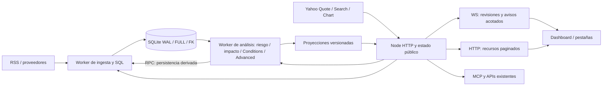

# P0: recuperación de SQLite, WebSocket y pipelines

## Alcance y dictamen

Trabajo local en `fix/p0-sqlite-ws-pipeline-recovery`, sin push ni merge. La candidata SQL conserva los archivos originales y sus backups. La activación de SQLite en el entorno del operador sigue pendiente: la revisión automática rechazó una propuesta de migración automática durante el arranque por su alcance operativo. Se sustituyó por una herramienta explícita que exige una base candidata nueva y verifica el backup antes de importar.

La disponibilidad de HTTP, la conexión WebSocket y la calidad de los pipelines son estados distintos. Las pruebas controladas descritas aquí no certifican producción ni un soak de 24 horas.

## Referencias comparadas

HEAD comprobados mediante fetch y reconfirmados con `git ls-remote` el 12 de octubre de 2026:

| Referencia | Commit |
| --- | --- |
| main, con PR #13 integrada | `a38bf74d97ef721d21ce7ddf87ba8512974e5a57` |
| PR #11, `feat/sqlite-worker-news-pipeline` | `f74eb9cb465aaf42fba99a7471c8f49c227742e9` |

La [PR #11](https://github.com/Santiagovargas32/ogid/pull/11) seguía abierta, en borrador y no fusionable. Su diff histórico contiene 122 archivos, 4.641 inserciones y 466 eliminaciones. Se aplicó una integración de tres vías desde su base común, seguida de resolución semántica y pruebas. No se sustituyeron archivos de main por versiones completas antiguas.

| Componente | Integración y conflictos resueltos |
| --- | --- |
| server.js | Adaptadores SQL y RPC de Yahoo; se conservaron métricas, start/stop single-flight, drenaje y manejo fatal de PR #13. Cutover explícito, sin activación automática. |
| RefreshOrchestratorService | Se conservaron RSS almacenado, cancelación, selección pendiente coalescida y ciclos independientes. Las cotizaciones se publican antes del análisis derivado. El adaptador SQL adquiere RSS por el ciclo programado; el temporizador legado es opcional. |
| StateManager | Se conservaron revisiones de noticias y estado público. Se añadieron lectura por recurso y snapshot de análisis acotado; stale no equivale a synthetic. |
| ResearchStore | Compatibilidad JSON instrumentada; producción SQL usa filas materializadas bajo demanda y transacciones incrementales dentro del worker. |
| NewsArchive | Se conservaron aliases y AtomicJsonWriter de main para compatibilidad. SQL no poda automáticamente artículos, contextos ni eventos históricos. |
| RSS y ProviderRuntime | Se conservaron equidad por host, AbortSignal, lectura limitada del body y límites por feed de PR #13. Persistencia precede a selección/análisis. |
| Market Conditions | Se reutilizaron cachés de series y revisiones completas de velas. CPU separada de la cola principal de persistencia. |
| Dashboard y Admin | Diseño news-first, sin restaurar mapa/hotspots. Se conservaron refrescos por sección y renders por revisión; se añadieron estado de pipeline y diagnósticos SQL. |
| Investigación y MCP | Se adaptaron consumidores asíncronos, histórico, datasets e identidades. Se mantienen perfiles y scopes existentes; nuevas rutas de sincronización se registran como lecturas almacenadas. |
| Tests | Se ejecutaron suites de main y PR #11 y se adaptaron pruebas que esperaban snapshots WS o precios sintéticos. |

Paquetes de implementación: `439712d` WebSocket, `15d6792` infraestructura/adaptadores SQLite, `435da25` migración y preservación histórica, `03b2f27` pipelines y análisis, `e629793` mercado y `0e32469` escritor único y drenaje de análisis. El commit de evidencia incluye las verificaciones finales del transporte, bootstrap del dashboard y sus pruebas. SQLite precede al cutover research para que los paquetes tengan sus dependencias disponibles. Se añadió un paquete de almacenamiento tras reproducir contención durante la validación real.

## Revisión de CI de PR #14

El 12 de octubre se revisó la [PR #14](https://github.com/Santiagovargas32/ogid/pull/14), abierta y fusionable, con HEAD `28d82999cf57a274e70db2e1aa8cfdf5d840a051` y base main `a38bf74d97ef721d21ce7ddf87ba8512974e5a57`. La [ejecución CI 59](https://github.com/Santiagovargas32/ogid/actions/runs/38294883957) falló exclusivamente en `inventory:check`: las instalaciones y comprobaciones de sintaxis pasaron; tests, build y audit quedaron sin ejecutar.

La implementación registró `intel.sync` e `intel.changes` en `backend/contracts/ogidOperations.js`, pero no regeneró `integrations/ogid-mcp/API-MCP.md`. El generador compara exactamente el archivo con la salida del registro. El documento todavía describía 71 rutas y 80 operaciones; el contrato describe 73 rutas y 82 operaciones. Se reprodujo el fallo con Node 22.23.3, por lo que no depende de Node 24.21.0 del runner. La corrección consiste en ejecutar `npm --prefix integrations/ogid-mcp run inventory` y versionar el resultado; se conserva la comprobación estricta de CI y no se modifican permisos ni contratos.

Validación local posterior con Node 22.23.3: inventario correcto (73 rutas, 49 operaciones research y 33 operator), sintaxis backend/MCP y build correctos, 694/694 tests backend, 23/23 tests MCP y `npm --prefix backend audit --omit=dev --audit-level=high` con cero vulnerabilidades. Estos resultados no sustituyen una nueva ejecución de Actions sobre el commit corregido con Node 24.

No se recomienda fusionar #11 antes ni después de #14: sus componentes ya fueron integrados y adaptados en esta rama. Se reconfirmó su HEAD `f74eb9cb465aaf42fba99a7471c8f49c227742e9`, estado de borrador y conflictos. Una simulación con `git merge-tree --write-tree` sobre el HEAD de #14 produjo 33 conflictos, incluidos server, orquestador, StateManager, repositorios SQL y dashboard, sin alterar el checkout. El orden recomendado es publicar la corrección del inventario en #14, obtener CI verde y revisar #14 para su fusión conforme al dictamen operativo de este documento. #11 puede cerrarse como sustituida cuando #14 esté integrada; no es una dependencia pendiente de fusión.

## Evidencia de octubre y causas

El registro aportado sitúa el handshake en `12:15:42.164` y la desconexión en `12:15:48.184`: 6.020 ms, cliente `192.168.1.48`, servidor `192.168.1.50:3000`, `/ws`, código observado 1006 y motivo interno `resync-required`. Ese registro no contiene el nombre ni los bytes del frame exacto. No permite atribuir retrospectivamente el cierre concreto a bootstrap, update o acumulación de mensajes.

Sí se reprodujo la condición defectuosa de main: un envelope `snapshot` construido con el ledger Awareness de disco pesa **1.431.331 bytes** y solicita 1013 con bufferedAmount cero. Es un fixture construido con datos existentes; el ledger de disco no equivale necesariamente a la proyección pública del StateManager. La prueba confirma el rechazo de un payload grande sin cliente lento. La antigua condición mezclaba el tamaño de un frame con el backlog TCP; el cierre TCP a un segundo también podía impedir completar el handshake de cierre. El contrato nuevo elimina todos los snapshots automáticos del canal WS.

Research contiene exactamente **20.000 eventos y 19 jobs**, revisión **1115**, **37.476.515 bytes**. Añadir un evento reprodujo `RESEARCH_CAPACITY` en aproximadamente **286 ms**. El límite alcanzado era el de registros, no 64 MiB. Eventos aportan 37.440.677 bytes; jobs, 35.701. Clonar, serializar y reescribir el ledger completo por transacción era el coste estructural. [Auditoría reproducible](p0-evidence/ledger-audit.json).

`market_router_completed` con liveCount=0/fallbackCount=0 no demuestra ausencia de observaciones. En los logs locales del 9/10 de octubre aparece webDelayedCount=18; el snapshot guardado contiene 18 precios válidos. El probe controlado actual obtuvo **18/18 quotes**, Search y Chart utilizables, sin rechazos ni rate limits. Se conservaron los tiempos bursátiles originales, incluidos cierres anteriores de EE. UU. No se ha confirmado una indisponibilidad actual de Yahoo ni se ha cambiado a Twelve Data. Ahora el router registra usable/webDelayed/unavailable, rechazos y causa por instrumento; con cero datos devuelve unavailable y conserva observaciones previas como stale. [Probe](p0-evidence/yahoo.json).

RSS informó rawCount=900, count=458, candidateCount=80, articleCount=62 y 6.338 ms en el registro aportado. Son conteos de etapas distintas. Awareness está configurado visible; el archivo local conserva 1.030 eventos y 22 estados: 10 active, 5 shadow, 3 probing y 4 blocked. `eligibleSources()` también aplica nextEligibleAt: sourceCount cero no significa que se haya procesado el catálogo. Los bloqueos de admisión se conservan, incluidos 403 persistentes y fuentes sin contrato estable; no se promueven silenciosamente.

## Arquitectura



StorageManager mantiene colas por items y bytes, separa espera/ejecución/total y limita CPU a un comando por worker de análisis. Lecturas rápidas preceden trabajo lento; tareas con antigüedad recuperan prioridad. La terminación del worker de análisis no destruye la persistencia principal. El timeout de un comando ya despachado se informa como outcome unknown; no se reintentan escrituras inciertas ciegamente. Un proceso nuevo recupera los commits SQLite.

El ensayo nativo inicial encontró `SQLITE_BUSY` al persistir `news-projection` desde análisis durante una transacción de ingesta. Se corrigió con **un escritor principal**: análisis usa `PRAGMA query_only=ON`, delega por RPC las proyecciones y los registros de análisis, y refresca su lectura de señales almacenadas. El registro y la limpieza de cursores corresponden al worker principal. El apagado drena primero los análisis aceptados y después su escritor; la infraestructura sin worker de análisis conserva el cierre inmediato. No se aumentó busyTimeout.

`lastQueueMs`, `lastExecutionMs` y `lastTotalMs` distinguen espera de ejecución. `lastCpuMs` usa CPU del hilo sólo en el worker de análisis serializado; es null cuando Node no ofrece esa medida y en el worker primario, cuyos comandos pueden solaparse. No se atribuye CPU global a una consulta individual. Los fallos de persistencia de etapas se publican al panel y el bloqueo se retira tras una escritura posterior correcta.

El análisis de mercado tiene un resultado pendiente sustituible y uno activo; publica sólo si coincide la revisión de mercado capturada. La ingesta de precios y su endpoint HTTP continúan mientras ese cálculo espera. Riesgo diario se acumula sobre todos los candidatos elegibles antes de limitar la selección visible; truncación de análisis/cobertura se declara en metadata.

## Contrato WebSocket v2

| Evento | Contenido |
| --- | --- |
| ws:ready:v2 | protocol=2, epoch, revisión global, revisiones por recurso y URLs HTTP |
| state:revision:v2 | Invalidación sustituible; incluye todas las revisiones actuales para que coalescer no pierda recursos |
| resync:required:v2 | Motivo y mecanismo HTTP de recuperación |
| heartbeat | Liveness del transporte, independiente de calidad del pipeline |

AI y Awareness se convierten en revisiones de sus recursos. Los avisos de Media conservan su contrato pequeño y sus endpoints de lectura.

`GET /api/intel/sync` devuelve el manifiesto. Con resource, epoch, revision y cursor devuelve fragmentos JSON de hasta 8.000 caracteres; aun con escaping están por debajo de 64 KiB. El cliente concatena y parsea antes de publicar. Una revisión caducada devuelve 409 y un manifiesto nuevo; no se mezclan páginas de revisiones diferentes. `GET /api/intel/changes?epoch=...&since=...` combina invalidaciones retenidas. Epoch distinto o journal caducado exige snapshot HTTP. El journal de 256 entradas conserva invalidaciones, no hechos históricos: éstos se recuperan por las APIs SQL con sus cursores.

Presupuestos predeterminados: frame 64 KiB, bufferedAmount 256 KiB, cola 256 KiB/64 entradas, bloqueo persistente 10 s, gracia de cierre 5 s. No se aumentó el antiguo límite de 1 MB para resolver el problema. Se distinguen payload-too-large, presión temporal, cola llena y cliente bloqueado; sólo estado sustituible se coalescea. El cierre registra código solicitado, código observado, anomalía 1006 y close frames cuando la biblioteca expone esa información.

Configuración: `WS_MAX_MESSAGE_BYTES`, `WS_MAX_BUFFERED_BYTES`, `WS_MAX_QUEUE_BYTES`, `WS_MAX_QUEUE_ITEMS`, `WS_SLOW_CLIENT_MS` y `WS_CLOSE_GRACE_MS`. Los valores se prueban desde la configuración real del servidor. Si ni siquiera cabe el manifiesto de recuperación, se cierra con 1013 sin recursión de mensajes; el endpoint HTTP permanece disponible.

Métricas incluyen connectionId, evento, bytes, buffers, presupuesto, serialización, pendientes, revisión y duración. Las muestras de transporte están acotadas. El frontend mantiene cursor por recurso y sincronización single-flight; reconnect usa backoff exponencial con jitter, limpia listeners/timers y conserva filtros. Una conexión activa no pone el indicador de pipeline en healthy.

El dashboard usa el manifiesto y los fragmentos v2 tanto al arrancar como en polling de respaldo. El endpoint snapshot antiguo se conserva para compatibilidad de APIs; el cliente sólo lo solicita si un backend anterior devuelve 404 para sincronización v2. Manifiestos HTTP tardíos no rebajan revisiones ni revierten un epoch nuevo. El markup de quotes se sustituye sólo cuando cambia su contenido, incluida frescura; el feed conserva su control por revisión.

## Migración, integridad y retención

Se reutilizaron migraciones 001–007 con checksum intacto. 008 añade estados por etapa. Constraints, foreign keys, índices y SQL parametrizado se conservan; WAL y synchronous=FULL se comprueban. WAL requiere el mismo host y almacenamiento con garantías de bloqueo: [documentación oficial SQLite](https://sqlite.org/wal.html).

La herramienta exige `--db` apuntando a una candidata inexistente. Nunca sobrescribe una base anterior. Copia archivos relevantes con hashes SHA-256 y verifica que los orígenes no cambien durante el corte. Manifests, transacciones e import.ready permiten verificar/repetir la importación sin duplicar hechos. No hay dual writes de negocio durante el cutover.

| Datos originales | Resultado comprobado |
| --- | --- |
| Eventos / jobs | 20.000 / 19, payloads iguales |
| Holdings / companyFacts / sourceStates / forecasts | 0 / 0 / 0 / 0, conteos iguales |
| Revisión research | 1115 preservada |
| Artículos / contextos | 33.334 / 123, todos los payloads comparados |
| Quotes históricas | 2.173 líneas, todos los payloads presentes; 2.170 payloads únicos |
| Velas históricas | 24.891, todos los payloads presentes en filas/revisiones |
| Integridad / FK | ok / cero violaciones |
| Backup SQLite | Verificado, 598.700.032 bytes |

[Evidencia de migración](p0-evidence/migration.json), [observaciones](p0-evidence/observations.json), [backup](p0-evidence/backup.json), [volumen](p0-evidence/volume.json).

Se verificó WAL, lector concurrente, bloqueo de escritor y commit/rollback tras SIGKILL en un subdirectorio temporal del volumen local. No simula un corte de alimentación. Artículos, contextos y eventos no se podan automáticamente en SQL. Sólo se caducan snapshots/cursores temporales. Las proyecciones y límites de memoria no son políticas de borrado de hechos; retención histórica futura exige una operación explícita.

La ingesta SQL de archivo y sus eventos comparte transacción. La importación de quotes distingue también observaciones con el mismo precio/fecha y distinta procedencia, manteniendo idempotencia para duplicados idénticos. Una regresión comprueba explícitamente ese conflicto.

## Rendimiento y pruebas

Runtime de validación: Node 24.10.0 instalado temporalmente; SQLite nativa 3.53.4. El harness breve es idéntico en main y reparación: 60 s, diez clientes, fixtures RSS, dos instrumentos y sin cuotas externas. No mide toda la operación Fedora.

Tras reanudar la sesión se utilizó Node 22.23.3 disponible en el host. La suite y el ensayo nativo se identifican con esa versión; sus cifras no se mezclan con la comparación breve en Node 24. El ensayo anterior de 18 instrumentos se interrumpió a los 25,45 minutos sin resultado final: [registro incompleto](p0-evidence/interrupted-native-run.json), sin certificación de treinta minutos.

| Métrica comparable, 60 s | main | Reparación |
| --- | ---: | ---: |
| Ciclos | 23 | 22 |
| Bytes WS | 23.054.780 | 384.890 |
| Cierres inesperados | 0 | 0 |
| HTTP p50 / p95 / p99, ms | 81,18 / 125,25 / 312,47 | 85,11 / 125,88 / 131,33 |
| Event-loop p95 / p99, ms | 12,07 / 37,09 | 11,06 / 32,42 |
| CPU user+system, s | 13,52 | 15,62 |
| RSS final, MiB | 418,55 | 395,36 |

La reducción comparable de WS es **98,33%**. No se afirma mejora de CPU ni de latencia p50/p95; no se extrapolan estas muestras a producción. Main y reparación transfieren además HTTP. Los 991 MB/30 min publicados en PR #13 corresponden a otro ensayo; no son un baseline directamente comparable con el corpus migrado. El harness aloja servidor y clientes en un mismo proceso: RSS/CPU incluyen ambos; heap de `process.memoryUsage()` corresponde al hilo principal. El soak también mantiene diez copias cliente del recurso artificial de 11 MB, por lo que su memoria no representa un servidor aislado.

El primer soak completó **1.800.000 ms de carga**, 1.828.073 ms totales: diez clientes, corpus migrado, RSS local continuo, recursos de 11 MB, dos instrumentos fixture, dos reconexiones y reinicio. Resultado: **cero cierres inesperados**, 12 cierres provocados, **96.680 eventos**, 37.000.843 bytes WS, 706.815.673 bytes HTTP de sincronización (incluye bootstrap/reinicio grandes). Advanced+Conditions concurrentes: p50 3.620 ms, p95 5.171 ms, máximo 5.204 ms. HTTP interactivo p95 116,68 ms; event-loop p95 11,01 ms. Integridad ok, FK vacías y colas drenadas. La reducción WS no debe interpretarse como eliminación del tráfico de recuperación HTTP.

El primer ensayo nativo de 18 instrumentos terminó treinta minutos con cero cierres inesperados, pero su log contenía un `SQLITE_BUSY` recuperado. No se certificó su pipeline: [resultado previo al escritor único](p0-evidence/native-30m-before-single-writer.json). El campo errors del harness original no contaba ese fallo capturado por el orquestador; ahora verifica también degraded/blocked/failed tras cada ciclo. La evidencia anterior incluye expresamente el fallo observado.

El ensayo **con escritor único** completó **1.800.000 ms de carga**, 1.843.319 ms totales, **154 ciclos**, diez clientes, los **18 instrumentos originales y 24.891 velas**, RSS continuo, dos desconexiones provocadas y reinicio. Resultado: **cero errores registrados, cero cierres inesperados**, 12 cierres provocados, **75.440 eventos**, integridad ok y cero violaciones FK. Las colas terminaron vacías. [Evidencia completa](p0-evidence/soak-30m-native.json).

| Medida, ensayo nativo de 30 minutos | Resultado |
| --- | ---: |
| Payload WS total / máximo individual | 27.451.113 bytes / 474 bytes |
| HTTP de sincronización, incluye bootstrap y reinicio de 11 MB | 1.387.624.850 bytes |
| HTTP interactivo p50 / p95 / p99 | 153,55 / 192,39 / 243,35 ms |
| Advanced + Conditions concurrentes, 16 muestras: p50 / p95 / máximo | 4.877 / 6.387 / 6.387 ms |
| Event-loop p95 / p99 / máximo | 11,30 / 17,91 / 342,36 ms |
| CPU user + system del proceso del harness | 1.753,27 s |
| RSS final / máximo muestreado del harness | 972,16 / 1.268,03 MiB |

No apareció la latencia de 65–70 s de PR #11 en esta carga. Eso no descarta otras consultas, conjuntos de datos o hardware. Estas cifras no se comparan directamente con el harness pequeño de main; el tráfico HTTP y el coste de CPU permanecen explícitos.

Resultado final de suites: **694/694 backend**, **23/23 MCP**, `npm run check` correcto. [Conteos](p0-evidence/tests.json). Incluyen main/PR #11; payloads pequeños, >1 MB y >10 MB; cliente lento y colas; eventos perdidos/epoch/revisión; Origin rechazado, localhost y LAN del mismo host; crecimiento research incremental y rollback; awarenessEvents tras 20.000 eventos; migración/backup íntegros; worker terminado; Yahoo vacío/validación; RSS activo; análisis concurrente y publicación de quotes mientras el cálculo está bloqueado. La nueva regresión de arranque habilita realmente los ciclos de fondo SQL, ingiere un feed HTTP local y comprueba las filas persistidas.

El replay de la versión final usa los 18 instrumentos y 24.891 velas: 60 s de carga, 93,21 s totales, cinco ciclos, cero cierres inesperados y cero errores. Advanced/Conditions concurrentes tardaron 4.850 ms en su única muestra; HTTP p95 182,25 ms. Una muestra del worker de análisis registra 1.762 ms en cola, 3.035,63 ms de ejecución, 4.798 ms totales y 2.149,46 ms de CPU del hilo. Es una muestra, no un percentil de transacciones. Se ejecutó en paralelo con el soak largo y no se compara contra main. [Replay](p0-evidence/final-native-replay.json).

El ensayo nativo con escritor único ya incluye su telemetría. Los ajustes finales del bootstrap del dashboard y del drenaje al apagar se comprobaron después con la suite y el navegador; no se atribuye al soak cobertura de rutas que no ejecutó.

Chromium 141/Playwright 1.56 comprobó cinco y diez pestañas reales: corte TCP + red offline, noticia nueva durante el corte y diez pestañas recuperadas con esa noticia, sin pageerror. Intervalos de fixture respetan la frecuencia del feed canónico. No se probó un dispositivo LAN remoto. `npm start` sin supervisor arrancó contra la candidata aislada; la selección en NODE_ENV=test estaba vacía, de modo que ese smoke no certifica quotes del operador.

Además, dos procesos reales arrancados con `npm start` y una base temporal nueva verifican SIGKILL/reinicio: el segundo recupera exactamente el hecho comprometido y su provenance, HTTP 200, integridad ok y cero violaciones FK. [Resultado](p0-evidence/process-restart.json). El script nunca mata un proceso del operador.

La validación final de Chromium se repitió **sobre SQLite**: cinco/diez pestañas, 18 filas por pestaña, precios iguales a los servidos (incluidos los conservados por la política de caché/sesión), noticia publicada durante el corte y reinicio del backend en el mismo puerto. Diez reconexiones automáticas recuperaron la noticia y el epoch nuevo. **Cero pageerror y cero solicitudes al snapshot HTTP antiguo**. Una actualización exclusiva de pipeline conserva los mismos nodos de quotes y noticias. [Evidencia numérica, sin contenido del corpus](p0-evidence/browser-sql.json).

## Criterios de aceptación y límites

| Criterio | Evidencia controlada y pendiente operativo |
| --- | --- |
| A: WebSocket | PASS controlado: 30 minutos, cero cierres inesperados, reconexión y reinicio. LAN remota pendiente. |
| B: Snapshot | PASS: máximo WS 474 bytes en soak; payloads >1/>10 MB recuperados mediante páginas HTTP. |
| C: Research | PASS SQL: 75.440 eventos en soak y awarenessEvents tras superar 20.000; JSON compatible conserva su límite hasta activar SQL. |
| D: SQLite | PASS controlado: integridad, FK, backup y SIGKILL/reinicio. No certifica pérdida de alimentación. |
| E: Mercado | Probe Yahoo 18/18; fixtures de rechazo/timeout/cero datos con causa y frescura. No certifica disponibilidad futura del proveedor. |
| F: Pipelines | Soak del escritor único sin errores y colas drenadas; fallos inyectados visibles y recuperables. Bloqueos de admisión del operador se conservan. |
| G: Frontend | Chromium SQL 5/10 pestañas, corte y reinicio en mismo puerto, precios coherentes y noticia recuperada. Revisión completa con configuración del operador pendiente. |
| H: MCP | 23 pruebas y suites de rutas SQL; scopes/permisos conservados. |
| I: Runtime | npm start sin supervisor, ingesta SQL de fondo y recuperación de proceso verificados. |
| J: Rendimiento | Comparación de 60 s y cifras nativas publicadas. No se afirma mejora general de CPU, HTTP ni tráfico total. |

La activación del operador, la captura del frame original exacto, LAN desde un dispositivo independiente y el soak de 24 horas permanecen pendientes. No hay un PASS global de producción.

## Procedimiento Fedora y rollback

Con Node compatible disponible, desde la raíz:

```sh
npm --prefix backend ci
npm --prefix backend run check
npm --prefix backend test
npm --prefix integrations/ogid-mcp test
node backend/scripts/verify-p0-process-recovery.js
npm --prefix backend run storage:volume-check -- /ruta/local/ogid
node backend/scripts/audit-research-ledger.js
node backend/scripts/storage-migrate.js --check --db /ruta/local/ogid/candidata-nueva.sqlite
npm --prefix backend run storage:backup -- /ruta/local/ogid/candidata-nueva.sqlite /ruta/local/ogid/backup-verificado.sqlite
```

Antes de un corte operativo, detener los escritores originales y repetir la candidata si los hashes han cambiado. Verificar manifests, payloads, integridad y backup; conservar los archivos JSON, bases y backups anteriores. La ruta es configurable y persistente, relativa a backend si no es absoluta. Validar permisos, espacio y tipo de filesystem; no escoger NFS/CIFS ni asumir que un montaje desconocido ofrece WAL correcto.

La activación revisable consiste en configurar `STORAGE_ENABLED=1`, `STORAGE_BUSINESS_ENABLED=1`, `STORAGE_REQUIRE_IMPORT=1` y `STORAGE_DB_PATH` con la candidata validada, y arrancar `npm --prefix backend start`. Estos cambios no se han aplicado a .env. La configuración concurrente del operador se conserva. No requiere systemd/PM2.

La prueba de navegador es opcional fuera de CI: instalar Playwright 1.56 y Chromium en un directorio de herramientas, indicar `OGID_PLAYWRIGHT_MODULE` con la ruta absoluta a `playwright/index.mjs` y `PLAYWRIGHT_BROWSERS_PATH`, y ejecutar `node backend/scripts/verify-p0-browser.js`. No se añadió esa dependencia al runtime de producción.

Para repetir la prueba SQL del navegador, indicar `OGID_BROWSER_SOURCE_DB` con un backup SQLite consistente y `OGID_BROWSER_ROOT` con un directorio local de validación. El script crea su propia copia, usa cotizaciones fixture y deja intacta la base indicada. Tras activar la nueva versión, recargar las pestañas para cargar el cliente del contrato v2.

Para revertir antes de nuevas escrituras SQL: detener Node, restaurar la configuración anterior y arrancar main con sus JSON conservados. Tras nuevas escrituras SQL, no volver directamente a JSON: quedarían hechos nuevos sin exportar. Conservar SQL/WAL y hacer una exportación conciliada o recuperar el backup apropiado. No borrar -wal/-shm de una base activa ni copiar sólo el .sqlite como backup de un escritor activo; usar la API de backup verificada.

## Protocolo de 24 horas y recomendación de merge

El soak de 24 horas **no se ha ejecutado ni certificado**. Preparar volumen local suficiente y una copia consistente; ejecutar con fixtures:

```sh
OGID_SOAK_DURATION_MS=86400000 OGID_SOAK_ROOT=/ruta/local/validacion OGID_SOAK_SOURCE_DB=/ruta/local/backup-consistente.sqlite node --expose-gc backend/scripts/soak-p0-recovery.js
```

En el host real, completar además 5/10 pestañas desde localhost y un dispositivo LAN independiente, revisar todos los paneles con sus datos habilitados, MCP research/operator, OHLCV/Search/Media, y provocar una desconexión y un reinicio bajo supervisión. Muestrear por minuto CPU/RSS/heap, delay/ELU, HTTP, bytes HTTP+WS, colas, transacciones, revisiones y etapas. Inspeccionar crecimiento de WAL/base y checkpoints; repetir backup/integridad al terminar. No consumir cuotas de proveedores de pago para benchmarks. Conservar result.json y las horas de comienzo/final.

Merge recomendado sólo tras revisar esta rama y el corte operativo. Los tests y réplicas controladas son evidencia de implementación; la activación del operador, el frame exacto del incidente original, LAN remota y 24 horas siguen siendo límites explícitos. No se declara un PASS global de producción por HTTP 200 o WS conectado.
